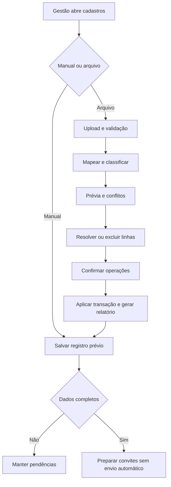
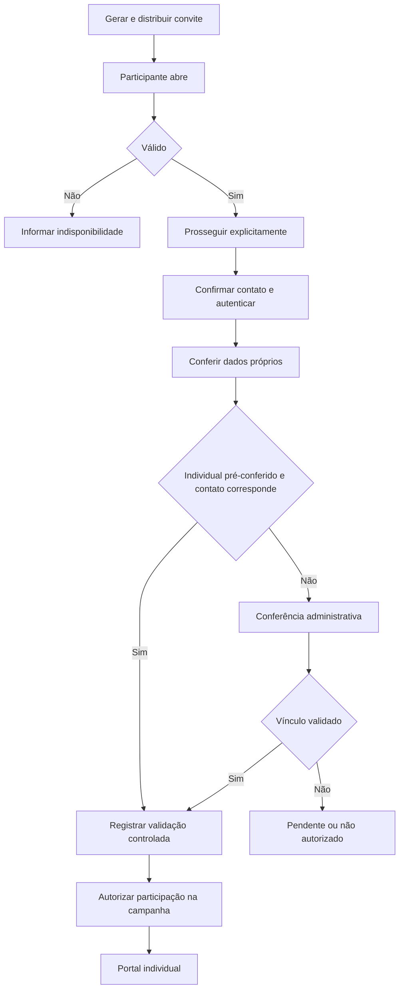
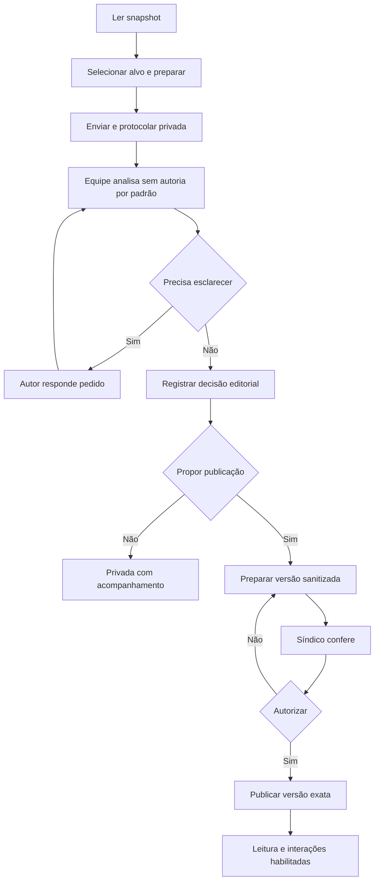
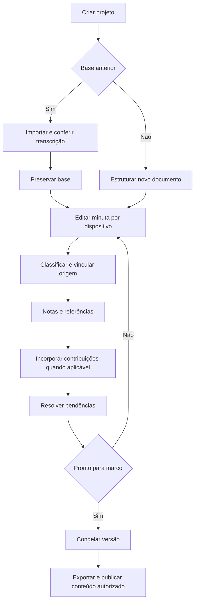
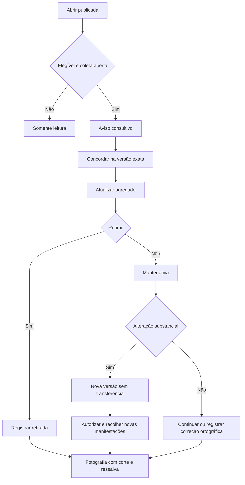

# PRD mestre — Gestão de documentos normativos condominiais

Versão: 3.0 consolidada  
Data: 08/10/2026  
Responsável de produto: Fabiano Chaves Silva  
Status: especificação proposta para desenvolvimento e homologação  
Idioma: português brasileiro  
Plataforma: web responsiva  
Arquitetura: React/TypeScript + Core Django/DRF + Supabase Cloud ou self-hosted

> Este é o documento normativo único de produto e arquitetura. Consolida as versões 2.0, 2.1 e 2.2 e substitui decisões anteriores incompatíveis. Os documentos auxiliares do pacote são extrações e instruções derivadas deste PRD; não constituem produtos ou escopos separados.
>
> Proibição absoluta: NÃO implementar votação, eleição, apuração de votos, cálculo de quórum, peso por fração ideal ou deliberação vinculante. O sistema gerencia criação e modificação de Convenção e Regimento Interno. “Concordo” é manifestação exclusivamente consultiva sobre uma redação publicada.

## Como utilizar este pacote

1. Colocar AGENTS.md na raiz do repositório e core/AGENTS.md no Core.
2. Adotar este PRD como fonte de verdade, mantendo sua versão no controle de código.
3. Iniciar pela fase 0, não por geração indiscriminada de telas.
4. Se houver aplicação existente, produzir análise de lacunas antes de modificá-la.
5. Usar os prompts por fase após conferir dependências e autorizações do ambiente.
6. Registrar testes, bloqueios e decisões. Não interpretar documentação de instalador como scripts já implementados.
7. O pacote contém especificação, contratos e instruções; não contém aplicação, infraestrutura já provisionada nem testes de software executados.

## 1. Visão, problema e resultado esperado

O síndico precisa organizar a evolução de documentos condominiais, preservar o texto anterior, registrar justificativas e incorporar contribuições sem perder a origem das mudanças. O produto deve apoiar criação sem base anterior, revisão de documento existente e revisão coordenada de Convenção e Regimento.

A proposta não é um editor de texto genérico. O documento é estruturado em dispositivos com identificadores permanentes, revisões, correspondência entre antigo e novo, notas internas, pendências e snapshots imutáveis.

O resultado esperado é responder: qual a redação atual, qual a proposta, o que mudou, de onde veio, quem revisou internamente, quais contribuições fundamentaram a mudança e qual versão foi publicada ou exportada.

Separar cinco camadas: arquivo original; transcrição conferida; minuta em evolução; contribuições/decisões editoriais; versões congeladas e artefatos exportados. Publicar conteúdo não significa aprovar norma.

## 2. Decisões consolidadas e limites

1. Web responsiva; aplicativo nativo fora do MVP.
2. Multi-condomínio com isolamento desde a fase inicial.
3. Monólito modular; processamento documental assíncrono.
4. Supabase PostgreSQL/Auth/Storage é a plataforma persistente padrão, Cloud ou self-hosted.
5. Core mantém autorização, domínio, transações e regras do produto.
6. Frontend, Core, workers e Supabase podem estar na mesma VPS ou separados.
7. Frontend não acessa diretamente tabelas de negócio.
8. Supabase Auth é a única origem de autenticação; não haverá credenciais Django paralelas.
9. Síndico pode cadastrar previamente e importar moradores por CSV/XLSX.
10. Cadastro prévio não cria conta nem envia convite automaticamente.
11. Convites individuais, por unidade, por torre/bloco, amplos e de leitura.
12. Acesso individual; não existe conta coletiva da unidade.
13. Confirmação de e-mail não comprova residência nem direito de voto.
14. Telefone e e-mail obrigatórios para interação; confirmação de telefone não é obrigatória no MVP.
15. Validação pertence ao vínculo. Uma pessoa pode possuir vários vínculos independentes.
16. Sugestão e complemento nascem privados.
17. Somente síndico ativo autoriza publicação de versões de sugestões.
18. Identidade e contatos de terceiros restritos a síndico/admin com permissão explícita.
19. Conselho, comissão e jurídico não recebem autoria automaticamente.
20. Concordâncias pertencem à versão e não migram em alteração substancial.
21. Snapshot e transcrição conferida não são editados silenciosamente.
22. IA não é dependência do MVP e não pode decidir, publicar ou editar autonomamente.

Exclusões: gestão financeira, cobrança, portaria, reservas, manutenção, rede social, registro cartorial automatizado, parecer jurídico automático e qualquer sistema eleitoral. Documentação externa pode ser guardada como anexo informativo; não haverá resultado de votação, lista eleitoral ou módulo de assembleia.

## 3. Vocabulário, governança e referências

- Documento-base: arquivo e transcrição conferida utilizados como origem.
- Dispositivo: artigo ou elemento estrutural com UUID permanente.
- Minuta: texto de trabalho, sem aprovação normativa presumida.
- Snapshot: fotografia imutável das revisões exatas.
- Acolhimento: decisão editorial, não incorporação automática.
- Incorporação: nova revisão documental vinculada à contribuição.
- Publicação: acesso a uma versão por público autorizado.
- Participante habilitado: identidade autenticada, contato confirmado, perfil ativo, vínculo elegível e autorização na campanha.
- Autoria não exibida: pessoa conhecida internamente, sem identificação nas interfaces públicas.

Nunca utilizar “aprovado” sem contexto. Usar “acolhida”, “publicação autorizada” e “versão final de trabalho”. Informação externa registrada não é validação pelo sistema.

Controle documental com responsável, revisões, acesso e histórico fundamenta o produto. [web:19][web:26] Orientações da ANPD fundamentam menor privilégio e proteção de acesso, sem garantir conformidade automática pela existência deste PRD. [web:12][web:14] Constituição e alteração de Convenção têm regras legais próprias, cuja aferição fica fora da aplicação. [web:41][web:42]

As referências são a base pesquisada nesta conversa, não monitoramento contínuo de legislação/releases. Regras técnicas são decisões de projeto, não afirmações de exigência legal.

## 4. Objetivos e indicadores

- Dispositivos organizados, classificados e com responsável quando necessário.
- Alterações com origem consistente, sem referência inventada.
- Sugestões com decisão registrada e devolutiva ao autor.
- Acolhimentos pendentes de incorporação identificáveis.
- Pendências por projeto, tema e responsável.
- Tempo de análise, sem pressionar conclusão inadequada.
- Participantes habilitados e unidades representadas, sem linguagem eleitoral.
- Nenhuma exposição indevida de identidade nos caminhos previstos.

Não apresentar progresso como segurança jurídica, likes como aprovação, ou participação voluntária como representatividade estatística de todos os residentes.

## 5. Perfis, permissões e identidade

| Papel | Responsabilidades | Identidade de terceiros | Publicação de sugestões |
|---|---|---|---|
| Síndico | Coordenar, editar, cadastrar, validar, publicar e exportar | Permissão específica, auditada | Sim, enquanto papel ativo |
| Admin do condomínio | Cadastro, importação, convites e operação | Somente permissão explícita | Não |
| Comissão | Redigir/analisar conforme concessão | Não | Não |
| Conselho | Revisar e comentar | Não | Não |
| Jurídico | Analisar texto e pendências | Não | Não |
| Morador | Consultar, sugerir, concordar, acompanhar | Somente próprios dados | Não |
| Leitor | Conteúdo autorizado | Não | Não |
| Operador técnico | Infraestrutura | Sem acesso ordinário pela interface | Não |

Papéis cumulativos não anulam restrições. Conselheiro/admin só acessa identidade pela permissão administrativa. Editor não publica. Síndico sem vínculo residencial administra, mas não recebe habilitação consultiva automática.

Permissões: document.read/edit/freeze/export; resident.create/import/validate/suspend; invitation.manage/distribution_export; identity.read; contact.read; identity.export; suggestion.review/publish/hide; campaign.manage/interact; statistics.read; audit.read; settings.manage.

Negar por padrão e verificar autorização em cada requisição, inclusive tarefas e acesso a arquivo. [web:106] Publicação exige papel de síndico ativo + permissão + recurso/versão elegíveis + confirmação. Não atribuir suggestion.publish a admin comum.

Papéis de gestão possuem início/término; mudança de síndico revoga poderes futuros e preserva autoria histórica. Acesso excepcional de suporte precisa autorização registrada, sem transformar operador em administrador de negócio.

## 6. Condomínios, torres e unidades

Condomínio → torre/bloco → unidade. Edificação única usa registro interno single; interface pode omitir campo ou dizer “Não se aplica”.

Código textual, preservando zeros e letras: 001, 101, 12A, CASA 05. UUID identifica unidade permanentemente. Código de prédio é único no condomínio; código da unidade é único no prédio.

Normalizar espaços externos e maiúsculas, sem remover caracteres significativos. Unidade não contém nome/telefone/e-mail do morador. Inativar preserva histórico e impede novos vínculos/autorização. Alterar rótulo exige auditoria e análise de impacto. Não permitir FK entre condomínios.

## 7. Cadastro prévio e ativação do morador

### 7.1. Cadastro manual

Campos: nome, telefone, e-mail, unidade, torre quando aplicável, relação declarada, fonte, responsável, observação restrita e referência externa opcional.

Pode ser salvo incompleto como ResidentRegistration. Registro prévio não é Account e não prova que o titular confirmou os dados. Não associar conta global só porque gestor informou um e-mail.

### 7.2. Associação verificada

Após convite: confirmar acesso ao contato → autenticar/criar identidade Supabase → apresentar dados próprios → completar/conferir → resolver divergência → criar/vincular Resident e UnitMembership → registrar associação ao cadastro prévio.

Não revelar ao gestor se e-mail possui conta em outro condomínio. Evitar mensagens que permitam enumeração de contas.

### 7.3. Correções

Nome/telefone com histórico; alteração de telefone remove sua confirmação. Alteração de unidade/relação exige conferência. Mudança de e-mail segue Auth com confirmação; convites associados ao endereço antigo devem ser revistos/revogados. Não reatribuir fatos passados.

Sem e-mail na lista: registro pendente, distribuição manual possível, mas participante completa/confirma e-mail e vínculo exige conferência; não tratar como convite individual pré-conferido vinculado a contato.

## 8. Importação cadastral

CSV UTF-8 e XLSX sem macros, modelo com instruções e dados fictícios. Colunas: nome, torre_bloco, unidade, telefone, email, relacao, referencia_externa. Nome/unidade e torre conforme estrutura são necessários para linha candidata; telefone/e-mail podem faltar no registro prévio, mas impedem ativação. Relação ausente vira other_authorized pendente de confirmação.

Upload → validar formato/limite → mapear → normalizar → prévia → classificar → resolver/excluir → confirmar → aplicar → relatório. Nunca modificar por upload nem enviar convite após importação.

Classificações: nova completa; nova pendente; existente igual; atualização proposta; vínculo adicional; conflito de identidade; unidade desconhecida; formato inválido; duplicada no arquivo.

Não executar fórmulas/macros. Rejeitar campos de fórmula no cadastro; preservar unidade textual. Exportação CSV neutraliza conteúdo interpretável como fórmula. Tipo declarado pelo cliente não basta; combinar checagem de extensão, conteúdo e tamanho. [web:105]

Não criar prédio/unidade silenciosamente. Nome/telefone não autorizam fusão. E-mail não é prova suficiente para mesclar pessoa. Associação com registro já ativado exige tratar divergência e proteger dados confirmados.

Limite inicial: 5.000 linhas/10 MB. Prévia restrita a permissões de importação/contatos. Idempotência por operação/lote/linha; reimportação legítima é possível mediante nova operação. Confirmar apenas linhas selecionadas resolvidas. Aplicação transacional do conjunto selecionado: falha impeditiva reverte aplicação, registra erro e exige nova prévia; falha de relatório não reaplica dados.

Desfazer lote exige ações compensatórias; não apagar perfis com participação. Auditoria guarda fonte e operações, sem duplicar payload pessoal em logs técnicos.

## 9. Convites e distribuição

Modalidades: individual vinculado a registro/contato; unidade fixa com limite configurável de resgates; torre/bloco; amplo; leitura sem interação. Links compartilhados não comprovam residência.

Selecionar campanha → destinatários/escopo → modalidade → validade/limites → conferência → gerar → distribuir. Copiar link recém-gerado, QR Code, mensagem para envio manual, exportação restrita e SMTP opcional com confirmação. Sem automação WhatsApp no MVP.

Sem e-mail confirmado, não liberar interação. Individual pré-conferido permite validação controlada somente após confirmar o contato esperado e com conferência administrativa registrada. Compartilhados exigem validação posterior.

Convite não é sessão. Abrir GET não resgata; POST explícito e confirmação apropriada. Token opaco criptográfico, apenas hash/verificador no banco, nunca completo em logs. Não reconstruir link de hash: reemitir invalida anterior. Exportação de links recém-gerados é arquivo privado temporário.

Validades padrão: individual 7 dias; compartilhado até fim da campanha; autenticação individual 15 minutos. Revogação/expiração/limite sempre verificados pelo servidor. Página sem trackers, HTTPS, no-referrer, remoção do token da URL, cookies seguros e limites de tentativas. OWASP fundamenta tokens individuais de autenticação, sem equipará-los a convites reutilizáveis. [web:59]

Convite: ativo/expirado/esgotado/revogado. Entrega: não enviada/enfileirada/enviada/falhou, sem inferir recebimento. Revogar bloqueia novos resgates, não suspende conta já ativada. Conta, perfil, vínculo, participação e papel têm suspensão/revogação independentes.

## 10. Validação e elegibilidade por unidade

Contato não confirmado/confirmado. Vínculo declarado/em verificação/validado/não validado. Operação ativo/suspenso/encerrado. Participação pendente/autorizada/suspensa/encerrada.

Padrão manual por síndico/admin autorizado: método, decisão, responsável, data e motivo. Métodos: cadastro do condomínio; confirmação direta; individual pré-conferido; outro descrito.

Elegibilidade: conta ativa, e-mail confirmado, perfil ativo, condomínio/prédio/unidade ativos, vínculo ativo validado, participação autorizada e recurso aberto na campanha.

Pessoa pode ter vários vínculos, vários moradores podem ocupar unidade. Uma participação por pessoa/campanha, um vínculo validado de referência. Trocar referência exige evento e revisão; fatos anteriores mantêm origem. Telefone compartilhado gera alerta, não bloqueio; IP não identifica pessoa.

Invalidar vínculo impede interações e exclui elegibilidade atual conforme motivo, preservando eventos. Fotografias anteriores não são reescritas; correção gera substitutiva explícita.

## 11. Projetos, documentos e estrutura

Projeto: objetivo, tipo, coordenador, equipe, datas, status, recursos e documentos. Tipos: criação, revisão, conjunta. Fluxo: preparação → estruturação → redação → consulta → consolidação → revisão opcional → final de trabalho → publicação de conteúdo → arquivamento. Retornos com motivo. Sem deliberação interna.

Documentos: Convenção/Regimento. Hierarquia flexível: título, capítulo, seção, subseção, artigo, caput, parágrafo, inciso, alínea. Preâmbulo, transitórias e anexos normativos. Bloco temático interno pode não aparecer no documento final.

Dispositivo tem UUID estável; revisão armazena conteúdo, pai, ordem, rótulo, tema, tipo de alteração, status e autor. Mover/renumerar não quebra comentários, origem e referências. Validar árvore sem ciclos.

Recursos configuráveis: comparação, diferenças, sugestões, anexos, campos personalizados, revisão jurídica, concordâncias e contagens. Desabilitar interface não apaga histórico.

## 12. Importação documental

DOCX, PDF textual, PDF digitalizado, imagens de páginas ou texto. Original privado preservado. Extração/OCR, segmentação sugerida e conferência humana com original lado a lado.

Não corrigir original silenciosamente; preservar irregularidades de numeração, marcar incerteza, registrar página quando disponível, unir/dividir trechos. Transcrição conferida é imutável; correção gera nova versão com motivo e impacto nos vínculos. OCR não é validação jurídica nem reprodução garantida.

Limites iniciais: 50 MB/300 páginas. Task assíncrona com progresso, timeout e recuperação. Conversor isolado, sem executar macros.

## 13. Editor, comparação e origens

Desktop: árvore + base somente leitura + minuta + contexto. Mobile: alternância ou vertical. Modos: minuta, lado a lado, diferenças, integral, alterações, pendências e sugestões.

Operações: criar, editar, mover, excluir da minuta, desmembrar, consolidar, classificar, vincular origem, inserir referência, revisar e restaurar como nova revisão.

Salvar após pausa, indicar pendente/salvando/salvo/erro. Só confirmar salvo após servidor. Controle otimista por revisão/ETag; conflito 412 para precondição desatualizada, 409 para conflito de domínio. Preservar conteúdo local para resolver, sem sobrescrita silenciosa. Sem edição em tempo real avançada no MVP.

Tipos: mantido, alterado, incluído, excluído, movido, renumerado, desmembrado, consolidado, reestruturado. Origem muitos-para-muitos, por dispositivo ou trecho. Novo item não inventa origem. Excluído sai do limpo, permanece em histórico/DePara. Pequena diferença textual não significa pequena consequência jurídica.

## 14. Numeração, referências e validações

Preservar numeração importada até escolha explícita. Renumeração com prévia e referências afetadas. Estratégias preservação/consolidação sem declarar uma juridicamente superior.

Referências apontam UUID; rótulos renderizados acompanham numeração. Converter referência importada exige conferência. Detectar rótulos duplicados, referência quebrada/alvo excluído, dispositivo vazio, marcador pendente, anexo ausente, origem faltante quando obrigatória.

Permitir estrutura provisória com pendências; gate de pronto bloqueia as pendências configuradas. Nenhum validador estrutural emite parecer de legalidade.

## 15. Observações, campos e tarefas

Separar texto normativo, justificativa compartilhável, nota interna, parecer, sugestão e evidência. Nota: revisão/alvo, autor, conteúdo, categoria, visibilidade, data e resolução. Padrão equipe autorizada; restrição adicional autor/gestão/jurídico conforme concessão.

Campos: texto curto/longo, seleção, data, número, sim/não e anexo. Definição tem tipo, descrição, obrigatoriedade, visibilidade e exportação. Sugeridos motivo, impacto, prioridade, risco, parecer, fonte e pendência.

Tarefas com responsável/status/prazo/alvo. Concluir tarefa não publica/incorpora automaticamente. Conteúdo interno nunca integra documento limpo por padrão.

## 16. Campanhas, sugestões e moderação

Campanha aponta snapshot e dispositivos, público, período, responsável e recursos. Minuta evolui em paralelo sem trocar silenciosamente texto consultado. Atualizar consulta exige nova etapa/versão explícita.

Síndico controla separadamente novas sugestões, listagem autorizada, complementos, concordâncias, contagens e respostas. “Todos” é público da campanha, não internet. Link de leitura compartilhável é opcional e sem identidade/interação.

Sugestão aponta documento/dispositivo/trecho/publicada/tema. Texto, justificativa, alternativa opcional, anexos e versão consultada. Rascunho privado → conferir → enviar com protocolo → fila. Chave idempotente evita duplicação técnica.

Estados independentes:

| Dimensão | Estados |
|---|---|
| Análise | recebida, em análise, aguardando esclarecimento, concluída |
| Editorial | sem decisão, acolhida, parcial, não acolhida, duplicada |
| Publicação | privada, pronta, publicada, ocultada, arquivada |
| Incorporação | não aplicável, pendente, incorporada, cancelada com motivo |

Duplicada exige vínculo à principal. Acolhimento parcial descreve parte acolhida. Resposta compartilhável separada de nota interna.

Conferir dados pessoais, ofensa, ameaça, acusação identificável, escopo e anexos. Preservar original; sanitizar versão pública com histórico. Mudança de sentido exige confirmação do autor ou identificar síntese da coordenação.

Somente síndico autoriza versão exata. Checklist: conteúdo analisado, dados conferidos, anexos, origem/status e redação pública. Lote exige seleção elegível e confirmação. Ativar listagem não publica pendentes.

Ocultar bloqueia busca/API/link/lista/interação; autor acompanha próprio conteúdo, histórico fica. Não prometer recolher cópias anteriores. Editar publicada gera revisão pendente. Sugestão sobre sugestão nasce privada; um nível no MVP. Promover alternativa conserva origem. Não somar manifestações de duplicadas/complementos.

## 17. Concordâncias consultivas e estatísticas

Botão “Concordo com esta proposta”. Aviso permanente: “Manifestação consultiva sobre esta redação. Não constitui voto, aprovação em assembleia ou alteração da Convenção/Regimento.”

Participante habilitado, recurso ativo, versão publicada/aberta. Autor não acrescenta concordância à própria contribuição. Uma concordância ativa participante/campanha/versão. Retirar/reafirmar enquanto aberto gera evento. Não interação não é discordância, apoio não determina acolhimento.

Mudança substancial em horário, valor, prazo, obrigação, proibição, responsabilidade, penalidade ou condição: nova versão sem transferência. Correção estritamente ortográfica pode manter com justificativa auditada; dúvida gera nova rodada.

Métricas: pessoas concordantes, unidades com ao menos uma concordância, pessoas habilitadas, unidades com habilitados. Não “unidade favorável”. Sem fração ideal. Percentual com denominador. Contagens ocultas por padrão e ausentes do payload; filtro popularidade opcional, ordem inicial tema/data.

Fotografia imutável: texto/versão, corte, elegibilidade, contagens e denominadores. Aviso de voluntariedade, não equivalência a votação e ausência de inferência sobre ausentes. Correções substitutivas, nunca alteração silenciosa.

## 18. Privacidade, retenção e auditoria

Mensagem: “Sua participação é identificada internamente. Somente o síndico e administradores autorizados do condomínio visualizarão sua identificação. Os demais participantes verão conteúdo autorizado.” Não chamar de anonimato completo nem garantir impossibilidade de inferência pelo texto.

API pública omite nome, unidade do autor, telefone/e-mail, ID de conta/perfil/vínculo correlacionável e identidade de concordantes. Sem avatar/perfil público. Serializers administrativos/públicos separados. Notificações e exports seguem regra.

Acesso à identidade recolhido e auditado por ator/alvo/data/ação. Exportação pessoal exige permissão separada e confirmação. Importados ainda não ativados também são privados. Anexos não publicados automaticamente; conferir assinaturas, nomes e conteúdo.

Política de retenção configurada e aprovada antes de produção para cadastro, contato, contribuição, eventos, objetos e backups. Sem inventar prazo legal. Pedidos de correção/acesso/exclusão com análise/decisão e desassociação quando aplicável, sem apagar história indiscriminadamente.

Auditar importação, convite, validação, suspensão, grants, consulta à identidade, revisões, decisões, publicação, concordância, snapshots e exports. Logs técnicos mínimos com request_id, sem tokens/PII desnecessária. Usuário comum não edita auditoria.

## 19. Versões, publicação documental e exportações

Snapshots guardam revisões/ordem/rótulos exatos. Restauração cria nova revisão. Hash verifica integridade, não assinatura/aprovação. Marcos: estrutura, minuta, consulta, consolidação, revisão e final de trabalho.

Minuta exportada identificada como não aprovada pelo sistema. Final de trabalho não implica aprovação normativa. Evidência externa é anexo informativo com origem/responsável, sem certificação.

PDF/DOCX limpos: identificação, versão/status, texto normativo e anexos selecionados. Sem notas, contatos, sugestões individuais ou referência antiga não intencional. DePara: origem/texto/rótulo, destino/texto/rótulo, tipo e justificativa compartilhável, inclusive relações múltiplas.

Relatório interno com avisos de restrição, sem identidade em checkbox genérico de relatório público. Pacote externo: snapshot, comparativo, resumo e pendências; sem eleição/quórum/resultado. Estatística opcional com ressalva. Preservação JSON + objetos autorizados + manifesto/hashes, restrita e testada.

## 20. Arquitetura Supabase e topologias

Frontend React/TypeScript/Vite/Tiptap; Core Django/DRF; Celery/Redis; Supabase PostgreSQL/Auth/Storage; OCR Tesseract português e conversão LibreOffice isolada. pytest, Vitest e Playwright. Versões estáveis compatíveis fixadas na fase 0, lockfiles, sem imagem latest em produção.

Supabase self-hosting recomendado com Docker; fixar release upstream e overlays. [web:122][web:124]

| Perfil | Web/Core | Supabase |
|---|---|---|
| local-dev | local | desenvolvimento local |
| cloud-single-host | mesma VPS | Cloud |
| selfhost-single-host | mesma VPS | mesma VPS |
| external-supabase | hosts definidos | instalação existente |
| distributed | web, Core e workers separados conforme deploy | Cloud ou self-hosted remoto |

Portabilidade para Linux amd64 homologado, Docker/Compose e dependências documentadas. Outra arquitetura/plataforma/LXC exige testes e preparação; não configurar Proxmox automaticamente nem prometer qualquer SO.

Browser → Core → banco/Auth/Storage. Sem acesso de frontend às tabelas de negócio. Esquema app não exposto na Data API. Downloads/uploads por autorização Core e acesso temporário; arquivo sensível pode exigir proxy. URL assinada já emitida pode durar até expirar, mesmo após ocultação; política deve indicar limitação.

Domínio não importa SDK; adaptadores AuthPort/StoragePort/Persistence. Worker não presume disco do Core: usa StoragePort. Edge Functions não são requisito. Redis é fila/cache, não segundo banco de negócio.

## 21. Auth, sessões, RLS e credenciais

Supabase auth.users é origem de identidade. app.accounts usa mesmo UUID/subject e metadados locais, sem senha nem catálogo de login paralelo. E-mail de acesso pertence ao Auth; cadastro prévio tem contato independente até associação verificada.

BFF: Core conduz Auth, browser usa cookie opaco HttpOnly/Secure e SameSite apropriado. Tokens JWT/refresh protegidos no servidor, sem localStorage frontend. Callback de autenticação tem allowlist e proteção de estado/fluxo. Verificar assinatura/algoritmo permitido/issuer/audience aplicável/expiração/subject; não só decodificar. Suportar modelo de assinatura do projeto, não fixar HS256. [web:123][web:125]

MFA obrigatório para gestão em produção, testado no modo escolhido. Verificar estado local e papel em requisições, não presumir que JWT válido autoriza recurso.

Runtime PostgreSQL limitado, sem superuser/BYPASSRLS/ownership. Papel de migrations separado. RLS para dados por condomínio e identidade; FORCE RLS onde adequado, com teste. Acesso direto Django não preenche automaticamente auth.uid(): contexto parametrizado e local à transação account/tenant após autorização. Contexto ausente nega. Não usar claims de cliente ou header arbitrário. Testar pool reaproveitado e workers.

RLS complementa autorização, não protege contra comprometimento total do Core. Data API sem tabelas app; grants explícitos. Políticas de linha e constraints devem ser testadas. [web:91][web:93]

Segredos administrativos Supabase ignoram RLS e ficam somente no servidor, para operações elevadas específicas após autorização; não resolver erro RLS com service_role. [web:120] Preferir formatos suportados pela versão; compatibilidade legado isolada no adaptador quando necessária. Sem secret no VITE_, git, logs ou bundle.

## 22. Modelo de dados consolidado

### 22.1. Convenções e constraints

UUID, timestamps UTC com fuso exibido do condomínio, date para data civil. Tenant em entidades de negócio. FKs compostas impedem relação cruzada. CHECK só para regras locais; elegibilidade entre tabelas no serviço/transação. updated_at explicitamente atualizado.

### 22.2. Cadastro e identidade

| Entidade | Campos/regras mínimos |
|---|---|
| Condominium | id, name, status, timezone, timestamps |
| Building | id, condominium_id, code, name, kind tower/block/single, status; unique tenant+code |
| Unit | id, tenant, building_id, code, floor_label?, description?, status; unique prédio+code |
| Account | id igual subject Auth, status local, timestamps; sem senha/e-mail de login autoritativo paralelo |
| ResidentRegistration | id, tenant, nome, telefone?, email?, unit_id, relação, fonte, referência externa?, status, preverified_by/at?, linked_resident/membership?, import_row? |
| Resident | id, tenant, account_id, full_name, phone_e164, phone_verified_at?, status; unique tenant+account |
| UnitMembership | id, tenant, resident_id, unit_id, relação, verification_status, membership_status, method?, reviewed_by/at?, reason?, started_at, ended_at? |
| MembershipVerificationEvent | id, tenant, membership_id, previous/new status, método, motivo, actor, data |
| RoleAssignment | id, tenant, account_id, role, valid_from/until?, status |
| PermissionGrant | id, assignment/grupo, permission, scope |
| CoreSession | id opaco/hasheado, account_id, token envelope protegido, expiry, revoked_at?, metadata mínima |

Não tornar nome/telefone únicos. Cadastro prévio pode repetir contato em vínculos diferentes. Vínculo não encerrado único tenant+resident+unit; encerrados permitem retorno histórico. Decisão validada/rejeitada exige método/ator/data/motivo; ended exige ended_at >= started_at. Normalização de telefone não comprova titularidade.

### 22.3. Importação, convite e entrega

| Entidade | Campos mínimos |
|---|---|
| ImportBatch | id, tenant, file_id/hash, status, revision, mapping, totals, created/confirmed_by/at |
| ImportRow | id, batch, row_number, normalized_data restrito, classification, issues, selected, action, target/version?, result_id?; unique lote+linha |
| AccessInvitation | id, tenant, campaign, kind, registration/unit/building?, expected_contact?, hash, expiry, max/redemptions, status, actor |
| InvitationRedemption | id, invitation, account/resident?, date, idempotency key |
| DeliveryAttempt | id, invitation, channel, destination restrita, status, provider_ref?, error_code?, date |
| IdempotencyRecord | id, actor, tenant, operation, key, payload_hash, result_ref, expiry |

Login/confirmation Auth usa contratos Supabase; convite da campanha é entidade própria e nunca reutiliza token Auth como permissão permanente. Tipo determina campos obrigatórios.

### 22.4. Domínio documental

| Entidade | Campos mínimos |
|---|---|
| Project | id, tenant, name, purpose, kind, coordinator, status, dates/settings |
| Document | id, project, type, title, editorial_status, numbering_policy, source_transcription? |
| SourceFile | id, tenant, storage_key, filename restrito, MIME, size, hash, uploaded_by, state |
| SourceTranscription | id, document, source_file, version, status, checked_by/at?, replaces? |
| SourceProvision | id, transcription, parent?, kind, label, order, text, page refs? |
| Provision | id, document, kind, created_at; identidade permanente |
| ProvisionRevision | id, provision, number, parent_provision?, position, label, text, theme?, change_type, status, responsible?, author/date |
| OriginMapping | id, revision, source_provision, relation_type, excerpt?, reason? |
| CrossReference | id, revision, target_provision, label template, status |
| DocumentSnapshot | id, document, version label, purpose, frozen_by/at, hash |
| SnapshotItem | id, snapshot, revision, rendered_label, position; unique snapshot+provision |
| InternalNote | id, tenant, alvo explicitamente validado, revision?, content, visibility, author/date, resolved_at? |
| CustomFieldDefinition/Value | id, escopo, tipo, visibilidade, obrigatoriedade, valor validado |
| ReviewTask | id, alvo, responsible, status, due_date?, notes restritas |

Snapshot deve reconstruir pai/ordem/rótulos daquela versão, não árvore atual. Alvos polimórficos exigem integridade verificada ou FKs/checks de exclusividade.

### 22.5. Participação e auditoria

| Entidade | Campos mínimos |
|---|---|
| ConsultationCampaign | id, tenant, project, snapshot, name, state, start/end?, settings |
| CampaignParticipant | id, tenant, campaign, resident, reference_membership, status, authorized_by/at; unique campanha+resident |
| ParticipantReferenceChange | id, participant, old/new membership, reason, actor/date |
| Suggestion | id interno, public_id opaco, campaign, participant, submitted_membership, target, category, statuses, date |
| SuggestionRevision | id, suggestion, version, text, justification, alternative?, source_revision, actor/date |
| PublishedSuggestionRevision | id, revision, public_text, status, authorized_by/at, hidden_at?, substantial_change |
| PublicationDecision | id, published revision, action, reason, actor/date |
| SuggestionRelationship | id, parent published revision, child suggestion, kind |
| SuggestionDecision | id, suggestion, decision, shared_reason, internal_note?, actor/date |
| SuggestionIncorporation | id, suggestion, provision_revision, description, actor/date |
| ConsultativeAgreement | id, participant, published revision, membership_at_action, active, timestamps; unique participante+versão |
| AgreementEvent | id, agreement, agree/withdraw/reaffirm/invalidate, reason?, date |
| ConsultationSnapshot | id, campaign, cut, eligibility definition, version/text refs, totals, supersedes?, actor |
| Attachment | id, tenant, source_file, owner, visibility, publication authorization? |
| ExportArtifact | id, tenant, kind, source snapshot/settings, status, private key/hash?, actor/date |
| AuditEvent | id, tenant?, actor, action, resource, request_id, timestamp, metadata mínima |
| IdentityAccessEvent | id, tenant, actor, resident/suggestion, purpose?, timestamp |

Interações preservam vínculo no momento. IDs de autoria/vínculo não entram em DTO público. Usuários comuns não modificam eventos.

## 23. Migrations, código e organização

Fonte única de schema app: SQL em supabase/migrations, incluindo tabelas, grants, RLS, funções e sessão Core. Models Django do domínio managed=False; não duas engines criando tabelas. Bibliotecas com tabelas exigem decisão explícita compatível. Não ativar catálogo Django auth/admin como segunda identidade.

Auth/Storage internos são mantidos pela versão Supabase; não alterar manualmente nem copiar de outro modo sem procedimento homologado. Seed fictício somente sob comando em desenvolvimento. Runner de migration versionado, papel separado e exclusão mútua; não resetar remoto.

Estrutura:

```text
/
├── AGENTS.md
├── README.md
├── CHANGELOG.md
├── apps/web/
├── core/
│   ├── AGENTS.md
│   ├── api/
│   ├── domain/{tenancy,identity,registrations,invitations,documents,participation,moderation,audit}/
│   ├── application/
│   ├── infrastructure/supabase/
│   └── tests/
├── workers/
├── packages/api-contracts/
├── supabase/{migrations,tests,seeds}/
├── infra/{compose,supabase,proxy,env}/
├── scripts/
├── docs/{prd,adr,api,ui,deployment,phases,security}/
└── .env.example
```

Domínio em serviços/testes, API valida input/serializa, adapters resolvem infraestrutura. Sem regras centrais apenas em controller, UI ou task.

## 24. Instalação, configuração e operação

Variáveis da aplicação: APP_ENV, DEPLOY_PROFILE, PUBLIC_APP_URL, PUBLIC_API_URL, SUPABASE_MODE, SUPABASE_PUBLIC_URL, SUPABASE_INTERNAL_URL, AUTH issuer/audience, chave apropriada, segredo administrativo somente se necessário, DATABASE_RUNTIME_URL, DATABASE_MIGRATION_URL, REDIS_URL, ALLOWED_ORIGINS, chave de proteção de sessão.

Não equivalem automaticamente a nomes upstream: mapear conforme release. URLs públicas/internas distintas. Redirects Auth/SITE_URL consistentes com deploy, allowlist sem curinga amplo. Same-origin /api por proxy preferido; cross-origin exige cookies/CORS/CSRF testados e origens exatas.

Contratos dos scripts a implementar:

```bash
./scripts/install.sh --profile cloud-single-host --config ./deploy.env
./scripts/install.sh --profile selfhost-single-host --config ./deploy.env
./scripts/install.sh --profile external-supabase --config ./deploy.env
./scripts/install.sh --profile distributed --component core --config ./deploy.env
./scripts/install.sh --profile distributed --component web --config ./deploy.env
./scripts/doctor.sh --config ./deploy.env
./scripts/migrate.sh --config ./deploy.env
./scripts/backup.sh --config ./deploy.env
./scripts/restore.sh --config ./deploy.env --manifest ./backup-manifest.json
```

Scripts são requisitos, não executáveis entregues neste pacote. Validar SO/arquitetura/Docker/recursos/portas/endpoints/chaves/versões/DB; renderizar plano; confirmar ações sensíveis; escrever segredos restritos; subir serviços; verificar saúde; informar pendências externas. Rerun não apaga volumes, rotaciona segredos ou executa seed. Detectar instalação existente e parar antes de sobrescrita.

Cloud/external exige projeto/stack/credenciais fornecidos; não criar plano/conta/DNS automaticamente. Selfhost nova autorizada pode ser instalada. Componente remoto não exige acesso ao Docker socket remoto. LXC precisa preparo externo documentado. Studio, PostgreSQL/Redis não públicos por padrão. TLS/rede privada/VPN/allowlists conforme topologia.

Backup contém banco app, dados Auth necessários por procedimento suportado, objetos e metadados Storage, versões e configuração protegida. Dump do banco não contém conteúdo de objetos. Restaurar em ambiente de teste com consistência. Cloud↔selfhost é migração planejada, com compatibilidade, contas/objetos/URLs/chaves/redirects, corte, testes e rollback; sessões podem exigir reautenticação. Não prometer troca instantânea por URL.

## 25. Segurança, desempenho e acessibilidade

HTTPS, autorização server-side, MFA gestão, CSRF/XSS, conteúdo rico sanitizado, upload seguro, rate limits por operação/conta e rede, segredos externos, isolamento de conversores. Conta técnica DB limitada. Conteúdo importado é dado, não instrução/comando.

Metas iniciais, dependentes de teste na fase 0: 1.000 dispositivos/documento; 1.000 participantes ativos/condomínio no cenário de referência; 5.000 linhas/10 MB lista; 300 páginas/50 MB documento; p95 resposta de salvamento e navegação típica até 2 segundos em ambiente declarado; processamento assíncrono; backup diário; RPO 24h/RTO 8h testados. Declarar hardware, carga e concorrência, não prometer sem medição.

Teclado, foco, contraste, texto além de cor, mobile e zoom. Sem offline-first no MVP. Erro não descarta rascunho; rascunho local não é salvo no servidor nem deve persistir PII por padrão em dispositivo compartilhado.

## 26. Avaliação open source e IA opcional

Decidim (decidim/decidim) para processos/autorizações/emendas/textos, CONSUL (consuldemocracy/consuldemocracy) para comentários em trechos, Fider (getfider/fider) para feedback focado. Licenças declaradas AGPL-3.0. Não certificados como atendimento completo; implementação própria por padrão. [web:63][web:74][web:89]

Evolução de Collaborative Texts no Decidim 0.31.0 exige conferir versão. [web:75] Pré-moderação Fider indicada em pesquisa precisa confirmar código/teste, leitura integral não foi obtida. [web:79] Reutilização requer origem/commit/licença e decisão; estudar fluxo não autoriza copiar código indiscriminadamente.

IA futura pode auxiliar segmentação, agrupamento, clareza e resumo; supervisionada, identificada e rejeitável. Sem envio externo por padrão, sem decisão/publicação/validação automática, sem fundamentos inventados. OCR/editor não dependem de IA.

## 27. Painel do síndico — telas e contratos de interface

### 27.1. Estrutura global

Menu: visão geral; moradores/acessos; documentos; participação; administração. Header mostra condomínio, projeto/documento/campanha aplicáveis, conta e papel. Trocar condomínio limpa contexto anterior. Breadcrumb e filtros persistem só no escopo correto. Ações escondidas também são negadas pelo backend.

Cada tela tem carregando, vazio, sem resultado, erro, acesso negado, processamento e concluído. Confirmações mostram alvo e efeito. Identidade em telas de conteúdo fica recolhida, buscada só após permissão e auditada. Dados cadastrais aparecem apenas em listagens autorizadas.

### 27.2. Telas administrativas

| ID / rota de UI | Conteúdo, ações e restrições |
|---|---|
| S01 /painel | Dashboard: projetos, pendências, filas, convites e retomada. Não mostrar contatos, ranking pessoal ou aprovação do condomínio. Ações criar projeto, retomar editor, analisar e validar. |
| S02 /painel/pendencias | Lista por tipo/alvo/responsável/prazo; filtrar, atribuir, abrir origem e concluir com motivo. Concluir tarefa não publica nem incorpora. |
| S03 /painel/unidades | Torres/unidades, busca e situação; criar, editar, inativar/reativar; impacto de vínculos. Sem exclusão simples com histórico. |
| S04 /painel/moradores | Abas cadastros prévios, ativados, pendentes, suspensos; filtros unidade/origem/contato/vínculo/campanha; cadastro e detalhe com identificação, contatos, vínculos, convites, participação e histórico. Suspensões distintas. |
| S05 /painel/moradores/importar | Assistente arquivo→mapeamento→normalização→prévia→conflitos→confirmação→relatório. Quantificar ações e avisar que não envia convites nem cria credenciais. |
| S06 /painel/moradores/validacoes | Fila e detalhe de vínculo; método/motivo obrigatórios; validar, rejeitar, esclarecer, suspender/encerrar. Separar contato/vínculo/participação. |
| S07 /painel/convites | Listar modalidade/público/validade/resgates/entrega; wizard de geração, copiar link novo, QR, mensagem/export SMTP opcional; revogar/reemitir com efeito explícito. |
| S08 /painel/projetos | Nome, tipo, coordenação, etapas, docs e pendências; criar/configurar/arquivar preservando histórico. |
| S09 /painel/projetos/:id/documentos | Convenção/Regimento, base, transcrição, minuta, snapshot e campanhas; criar/importar/editar/comparar/exportar. |
| S10 /painel/documentos/:id/importacao | Original e extração, página, incertezas, união/divisão/hierarquia; conferência humana e nova transcrição posterior. |
| S11 /painel/documentos/:id/editor | Árvore, base somente leitura, minuta e contexto; modos e operações por dispositivo, indicadores de salvamento, conflito explícito. |
| S12 /painel/documentos/:id/revisoes | Estrutural, editorial, referências, jurídico e acolhidas sem incorporação; responsáveis, pendência, revisão e parecer. Sem selo de legalidade. |
| S13 /painel/documentos/:id/versoes | Snapshots, finalidade/responsável, leitura imutável, comparar/exportar/restaurar como nova revisão; nunca editar snapshot. |
| S14 /painel/exportacoes | Tipo/versão/perfil/anexos, prévia, fila e resultado; arquivo público sem PII e alerta para relatório interno. |
| S15 /painel/campanhas | Nome, snapshot, período, público, habilitados e recursos independentes; criar/abrir/fechar, toggles de leitura/sugestão/complemento/concordância/contagem. |
| S16 /painel/sugestoes | Fila por análise/editorial/publicação/incorporação, tema, alvo e campanha; abrir, atribuir, esclarecer e duplicidade, sem autoria automática. |
| S17 /painel/sugestoes/:id | Contribuição e contexto, decisão, resposta/nota separadas, identidade restrita, incorporação transacional e histórico. Detalhamento abaixo. |
| S18 /painel/sugestoes/publicacao | Original restrito e versão sanitizada, prévia pública, anexos e checklist; síndico autoriza/devolve/oculta. |
| S19 /painel/campanhas/:id/estatisticas | Pessoas/unidades, versões, denominadores/corte; filtro por tema, fotografia/export agregado. Sem linguagem eleitoral. |
| S20 /painel/equipe | Papéis/permissões/início/término/MFA; convidar, atribuir, revogar e troca de gestão. Identidade/export/publicação separados. |
| S21A /painel/administracao/auditoria | Eventos/filtros ator/ação/recurso/período; leitura restrita, sem editar/apagar. |
| S21B /painel/administracao/configuracoes | Dados/fuso, convites, limites, campos, SMTP, retenção/avisos; confirmar e auditar sensíveis. |

S21 era área única no mapa anterior; agora tem duas páginas efetivas, mantendo identificação histórica. São 22 páginas administrativas agrupadas em 21 áreas funcionais.

### 27.3. Editor detalhado

```text
Documento | Status | Salvamento | Visualização | Ações
----------------------------------------------------
Árvore estrutural | Documento-base | Minuta proposta
----------------------------------------------------
Propriedades | Origem | Notas | Sugestões | Histórico | Referências
```

Árvore mostra rótulo, tipo de mudança, status e pendências; não cor como única informação. Desmembrar/consolidar abre assistente com seleção de origem/destino e prévia. Renumerar mostra antes/depois/referências. Conflito exibe versão utilizada, atual e conteúdo local; resolução cria revisão consistente.

### 27.4. Análise de sugestão detalhada

Header: protocolo, tema, campanha, alvo, versão/data e responsável. Quatro indicadores separados: análise, decisão editorial, publicação, incorporação.

Coluna contribuição: original, justificativa, alternativa e anexos. Coluna contexto: texto consultado, base e minuta atual, com aviso se já mudou. Abas análise, decisão, publicação, incorporação e histórico.

Autoria por botão restrito, não carregada em payload padrão. Análise: síntese, impacto, revisão técnica necessária, responsável e notas. Decisão: acolhida/parcial/não/duplicada, resposta compartilhável obrigatória; parcial descreve recorte, duplicada exige alvo.

Publicação prepara texto/anexos e prévia, mas só síndico confirma. Incorporação seleciona dispositivos, abre proposta, salva revisão e vínculos na mesma transação; falha não deixa incorporada. Várias sugestões podem fundamentar revisão sem somar manifestações.

Histórico preserva revisões, pedidos, respostas, decisões e publicação, respeitando autoria restrita para leitores sem permissão.

## 28. Portal do morador

Navegação: consulta atual, documento, publicadas, minhas sugestões, minhas concordâncias, notificações e meu cadastro. Não reutilizar menu administrativo.

| ID / tela | Conteúdo e ações |
|---|---|
| M01 Entrada | Condomínio/campanha/período/regras/situação; prosseguir. Sem cadastro pessoal completo antes de contato verificado. |
| M02 Contato/cadastro | Confirmar contato e identidade Auth, conferir dados próprios, completar telefone/nome/unidade/relação; compartilhado pede validação. Sem enumeração de conta externa. |
| M03 Situação de acesso | Contato, dados, vínculo e autorização separados; responder esclarecimento e ver orientação. |
| M04 Início | Objetivo, snapshot/período/regras/recursos e últimas respostas; ler, sugerir e acompanhar. |
| M05 Documento | Árvore/busca/versão; sugerir por item. Mostra snapshot da campanha, não latest da minuta. |
| M06 Enviar | Alvo/categoria/texto/justificativa/alternativa/anexo; prévia e avisos; protocolo após envio idempotente. |
| M07 Publicadas | Filtros tema/alvo/status/data; cartão sem autoria, com versão/resposta/ações permitidas. |
| M08 Detalhe público | Redação exata, contexto, complementos autorizados, concordar/retirar/sugerir melhoria conforme abertura. |
| M09 Minhas sugestões | Privadas/publicadas/análise/esclarecimentos/decisão/incorporação, sem confundir status. |
| M10 Minha sugestão | Texto, respostas, revisões próprias, publicação/incorporação; sem notas da equipe; edição gera revisão pendente. |
| M11 Minhas concordâncias | Texto/versão/data/status; nova versão informada sem concordância presumida; retirar enquanto aberto. |
| M12A Meu cadastro | Dados/vínculos/contato/referência e pedidos de correção; unidade/relação sujeitos a conferência. |
| M12B Notificações | Validação, esclarecimento, resposta, publicação, incorporação, nova redação e encerramento; sem autoria de terceiro. |

Estados de acesso: convite não resgatado, contato pendente, cadastro incompleto, vínculo em análise, autorizado, suspenso e campanha encerrada. Encerramento mantém leitura permitida e acompanhamento próprio, sem interação nova. Suspensão não revela terceiros nem apaga histórico.

Mensagens específicas para convite expirado/revogado/esgotado/substituído/campanha encerrada. Canal da gestão pode ser configurado, sem contatos privados de moradores.

## 29. Diagramas das jornadas

### 29.1. Cadastro e importação



### 29.2. Convite e autorização



### 29.3. Sugestão e publicação



### 29.4. Revisão documental



### 29.5. Concordância por versão



## 30. API geral e contrato da importação

### 30.1. Padrões

REST JSON /api/v1, sessão BFF segura, CSRF, paginação, filtros validados, versões/ETag e request_id. OpenAPI deve refletir implementação. Campos públicos/administrativos distintos. Erros code/message/field_errors/request_id sem segredos e sem enumeração de outros tenants.

GET sem side effects. Mutações têm autorização e confirmação conforme UI. Idempotency-Key para operações com risco de duplicação; escopo actor+tenant+endpoint+key, hash do payload. Mesmo conteúdo devolve resultado anterior, diferente retorna 409. Retenção operacional da chave documentada e configurável.

### 30.2. Endpoints de domínio

- /condominiums/{id}/buildings, /units, /resident-registrations, /residents, /memberships.
- /memberships/{id}/review, /suspend, /end.
- /invitations, /invitations/batch, /invitations/{id}/revoke, /distribution-export.
- /access/invitations/inspect e /redeem; /access/login/request e callback/confirm definidos pelo Auth escolhido.
- /projects, /documents, /source-imports, /source-transcriptions/{id}/confirm.
- /provisions, /provisions/{id}/revisions, /origin-mappings, /snapshots, /exports.
- /campaigns, /campaign-participants, /suggestions, /suggestions/{id}/revisions e /review.
- /publication-authorizations, /published-suggestions/{public_id}/hide, /incorporations.
- /published-suggestions/{public_id}/complements e /agreement.
- /me/profile, /me/memberships, /me/suggestions, /me/agreements.
- /statistics/snapshots, /audit, /identity-access.

PUT agreement ativa, DELETE retira, ambos idempotentes e vinculados à versão. Recursos tenant podem usar prefixo explícito /condominiums/{id}; não confiar no prefixo sem checagem.

Transações: resgate/contagem/associação; vínculo/evento; publicação/decisão; acordo/evento; incorporação/revisão/vínculo; snapshot/itens. Não salvar estado parcial.

DTO público exemplo:

```json
{
  "public_id": "sg_identificador_opaco",
  "version": 2,
  "theme": "Áreas comuns",
  "provision_label": "Art. 22",
  "text": "Texto autorizado para consulta",
  "editorial_status": "under_analysis",
  "shared_response": null,
  "can_agree": true,
  "can_complement": true
}
```

Não enviar identidade nem aggregate quando oculto. Alvo não autorizado/oculto não expõe conteúdo em erro.

### 30.3. Estados da importação

received → parsing → awaiting_mapping → validating → awaiting_review → applying → completed. failed/cancelled adicionais. Completo informa operações aplicadas e linhas excluídas, não sucesso fictício para todas.

Base: /api/v1/condominiums/{condominium_id}/resident-imports.

| Método/rota relativa | Contrato |
|---|---|
| GET /template?format=csv ou xlsx | Modelo fictício |
| POST / | multipart file/source_label; chave idempotente; 202 com id/status/revision |
| GET /{id} | Status, totais e operação atual |
| PUT /{id}/mapping | JSON mapping, sheet/header/CSV opções; If-Match, nova revisão/validação |
| GET /{id}/rows | Classificação/filtros/paginação; dados restritos |
| PATCH /{id}/rows/{row_id} | Seleção/ação/motivo/target esperado; If-Match |
| GET /{id}/preview | Totais e can_confirm, revisão |
| POST /{id}/confirm | expected_revision, acknowledgment; If-Match e idempotência; 202 |
| POST /{id}/cancel | Apenas não aplicado; não cancelar transação parcialmente |
| GET /{id}/report | Relatório restrito |

### 30.4. Mapeamento e resolução

```json
{
  "sheet": "Moradores",
  "header_row": 1,
  "columns": {
    "nome": "Nome completo",
    "torre_bloco": "Bloco",
    "unidade": "Apartamento",
    "telefone": "Celular",
    "email": "Email",
    "relacao": "Tipo"
  },
  "csv_options": null
}
```

Ações conforme classificação: create_registration, update_registration, add_registration_for_unit, skip, request_manual_review. Update exige target e versão; sem merge genérico. Dados ativados divergentes viram conflito. Alteração de mapping/decisão incrementa revision e invalida prévia.

Row DTO: id, row_number, classification, selected, normalized_data restrito, issues(code/message), allowed_actions, proposed_action e target/version quando permitido. Linha desconhecida/erro bloqueante não selecionável sem resolução.

Prévia:

```json
{
  "revision": 5,
  "status": "awaiting_review",
  "summary": {
    "total_rows": 120,
    "selected_rows": 105,
    "create_registrations": 90,
    "update_registrations": 10,
    "add_unit_registrations": 5,
    "skipped_rows": 15,
    "selected_blocking_issues": 0
  },
  "can_confirm": true,
  "sends_invitations": false,
  "creates_credentials": false
}
```

Confirmar com expected_revision e acknowledge_selected_operations=true. Rever targets/permissões no processamento, exclusão mútua no lote. Falha impeditiva reverte conjunto e retorna para nova prévia ou failed com motivo. Relatório pode ser regenerado sem reaplicar lote.

### 30.5. HTTP e erros

202 é aceitação para processamento, não conclusão. 400 malformed, 401 sessão inválida, 403 operação proibida no escopo acessível, 404 fora do escopo/inexistente, 409 domínio/idempotência, 412 If-Match desatualizado, 413 limite, 415 formato, 422 dados semânticos, 429 rate limit. Semântica fundamentada em HTTP. [web:103]

```json
{
  "code": "IMPORT_PREVIEW_OUTDATED",
  "message": "A prévia mudou. Revise antes de confirmar.",
  "field_errors": {},
  "request_id": "req_identificador_opaco"
}
```

### 30.6. Autorização da importação

Exigir sessão administrativa, papel no tenant, resident.import e contact/identity necessários. Fonte/relatório privados. Nome de arquivo não vira storage path confiável. Limitar descompactação XLSX/tempo/memória além do tamanho de upload. Rejeitar macro/fórmula executável; não confiar em MIME declarado. [web:105]

## 31. Fases de desenvolvimento e gates

O MVP completo abrange fases 0 a 8. A fase 9 é opcional. Não estimar prazo sem capacidade real. Uma fase isolada não é produto completo.

### Fase 0 — Preparação e contratos

Dependências: Nenhuma.

Entregas: Repositório, inventário/gap analysis, ADR Supabase/BFF/RLS/migrations, versões e lockfiles, Docker de desenvolvimento, contrato API, protótipos, AGENTS, massa fictícia, hardware e carga de referência.

Gate de conclusão: Build base reproduzível; nenhum segredo; matriz de critérios; plataforma e DB role definidos; contratos sem votação.

Critérios de referência: AR-03, AR-11, AR-16, AR-18.

### Fase 1 — Identidade e estrutura física

Dependências: 0.

Entregas: Supabase Auth/BFF/MFA, papéis/permissões, RLS/contexto de pool, condomínio/torres/unidades, pré-cadastro manual, perfis/vínculos e validação auditada.

Gate de conclusão: Testes positivos e negativos de Auth, tenant e identidade; unidade/cadastro/vínculo sem misturar conta; sem Auth mock como integração concluída.

Critérios de referência: CA-01, CA-02, CA-06, CA-12 a CA-16, CA-33; AR-04 a AR-09.

### Fase 2 — Importação cadastral e convites

Dependências: 1.

Entregas: CSV/XLSX e modelo, mapping, prévia/conflitos, transação/idempotência, relatório, convites, resgate, associação, distribuição e SMTP opcional em sandbox.

Gate de conclusão: Arquivo malicioso/formulas/zeros, reenvio, contato incompleto, account existente, limite concorrente e revogação; jornada completa sem envio automático.

Critérios de referência: CA-03 a CA-11, CA-43; V21-06 a V21-25.

### Fase 3 — Núcleo documental

Dependências: 1; preferir após 2.

Entregas: Projeto/documento, arquivo original Storage, OCR/transcrição, estrutura, editor/revisões, notas/campos, conflitos e snapshot básico.

Gate de conclusão: Criar novo e revisar importado, recuperar task, árvore sem ciclos, snapshot reproduzível e nota privada.

Critérios de referência: CA-17, CA-18, CA-23, CA-24, CA-41; AR-10.

### Fase 4 — Comparação e exportação

Dependências: 3.

Entregas: Lado a lado/diferenças, classes de alteração, origem múltipla, referências/numeração, pendências, PDF/DOCX/DePara.

Gate de conclusão: Demonstrar todas as classes, novo sem origem, exclusão/consolidação/desmembramento, renumeração e exports conferidos.

Critérios de referência: CA-19 a CA-22, CA-42; UI-12 a UI-18.

### Fase 5 — Consulta e moderação

Dependências: 2 e 4.

Entregas: Campanha em snapshot, habilitação, portal, rascunhos/sugestões, quatro estados, esclarecimentos, versão sanitizada, autorização do síndico, ocultação e complemento.

Gate de conclusão: Privada→análise→publicação; revisor sem identidade, autor sem notas, toggle não publica pendentes e anexos sem automação.

Critérios de referência: CA-25 a CA-34; V21-26 a V21-28, V21-32, V21-36.

### Fase 6 — Concordâncias e consolidação

Dependências: 5.

Entregas: Acordo por versão/retirada/eventos, métricas pessoa/unidade, contagens ocultas, fotografia, substancialidade e incorporação transacional.

Gate de conclusão: Sem duplicação ou transferência, invalidação de vínculo preserva histórico, snapshot estatístico substitutivo e linguagem não eleitoral.

Critérios de referência: CA-35 a CA-40, CA-45; V21-29 a V21-31, V21-34, V21-37.

### Fase 7 — Preservação e publicação de conteúdo

Dependências: 6.

Entregas: Final de trabalho, leitura autorizada, pacote externo, relatório interno, JSON/manifesto, arquivo informativo externo, retenção/exportação.

Gate de conclusão: Recuperar estrutura exportada, separar identidade do público, nenhuma deliberação formal introduzida.

Critérios de referência: CA-41, CA-42, CA-45; UI-33, UI-38.

### Fase 8 — Hardening e produção

Dependências: 7.

Entregas: Homologação Cloud/selfhost e web/Core separados, instalador/doctor, carga, acessibilidade, monitoramento, backup/restauração, retenção, manuais e rollback.

Gate de conclusão: Todos critérios aplicáveis aprovados; restauração real em teste; MFA/segredos/rede; metas medidas; liberação humana expressa.

Critérios de referência: Todos CA/UI/V21/AR.

### Fase 9 — Evoluções opcionais

Dependências: MVP aceito e nova decisão de escopo.

Entregas: IA supervisionada, edição simultânea avançada, integrações autorizadas e modelos revisados. Sem votação também nesta fase.

Gate de conclusão: Novo planejamento/testes e ADR sem relaxar privacidade e missão. Não faz parte da entrega inicial.

Critérios de referência: Critérios afetados e regressão completa.

Piloto: massa fictícia com 2 torres, 10 unidades, vários moradores por unidade, pessoa em múltiplas unidades/condomínios, documento de 30 dispositivos e 20 sugestões diversas. Quantidades são cenário de teste, não limite operacional. Usar dado real somente com autorização e política definida.

## 32. Critérios de aceite, rastreabilidade e testes

Os identificadores anteriores são preservados por compatibilidade. Sobreposição é intencional; um teste pode cobrir vários IDs. A matriz deve ser completada com implementação, teste executado, evidência e resultado. Ter uma linha na matriz não significa teste aprovado.

### Grupo CA

| ID | Resultado obrigatório |
|---|---|
| CA-01 | Acesso entre condomínios negado no servidor e arquivos |
| CA-02 | Cadastro manual cria registro prévio sem credencial automática |
| CA-03 | Upload cadastral não modifica antes da confirmação |
| CA-04 | Unidade desconhecida não é criada silenciosamente |
| CA-05 | Reenvio de confirmação não duplica registros |
| CA-06 | Conta em outro condomínio não é revelada |
| CA-07 | Convite por unidade fixa unidade e mantém contas individuais |
| CA-08 | Convite amplo exige conferência de vínculo |
| CA-09 | Individual pré-conferido exige contato previsto confirmado |
| CA-10 | GET no convite não consome nem autentica |
| CA-11 | Revogação bloqueia resgate sem apagar perfil ativado |
| CA-12 | Dados incompletos não habilitam interação |
| CA-13 | Vários moradores podem ter vínculos na mesma unidade |
| CA-14 | Pessoa com várias unidades não ganha concordâncias extras |
| CA-15 | Confirmar e-mail não valida vínculo declarado |
| CA-16 | Mudança de unidade preserva referência das interações anteriores |
| CA-17 | Original documental preservado com conferência humana |
| CA-18 | Corrigir transcrição gera versão e não simula alteração normativa |
| CA-19 | Dispositivo incluído não inventa origem |
| CA-20 | Excluído sai do limpo e permanece em histórico e DePara |
| CA-21 | Desmembrar/consolidar preserva relação muitos-para-muitos |
| CA-22 | Renumerar preserva referência e comentários |
| CA-23 | Edição concorrente gera conflito sem sobrescrita |
| CA-24 | Nota interna ausente em API e export público |
| CA-25 | Sugestão privada recebe protocolo e versão consultada |
| CA-26 | Conselho analisa conteúdo sem identidade |
| CA-27 | Análise não publica automaticamente |
| CA-28 | Admin sem papel de síndico não publica |
| CA-29 | Toggle global mostra apenas versões autorizadas |
| CA-30 | Complemento privado e moderado independentemente |
| CA-31 | Edição publicada cria versão pendente |
| CA-32 | Ocultação bloqueia API link busca listagem e interação |
| CA-33 | Identidade exige permissão e auditoria |
| CA-34 | Anexo não publica automaticamente |
| CA-35 | Cliques repetidos produzem uma concordância ativa |
| CA-36 | Retirada atualiza agregado e preserva evento |
| CA-37 | Mudança substancial não transfere concordâncias |
| CA-38 | Contagem oculta ausente no payload |
| CA-39 | Estatística explicita texto versão corte denominador e ressalva |
| CA-40 | Incorporação liga revisão e contribuição atomicamente |
| CA-41 | Snapshot imutável e reproduzível |
| CA-42 | Documento limpo sem identidade notas ou referência antiga indevida |
| CA-43 | Distribuição restrita e envio real confirmado |
| CA-44 | Banco e objetos restaurados consistentemente |
| CA-45 | Nenhuma votação apuração ou cálculo de quórum |

### Grupo UI

| ID | Resultado obrigatório |
|---|---|
| UI-01 | Troca de condomínio limpa contexto |
| UI-02 | Menu e backend respeitam permissões |
| UI-03 | Telas têm loading vazio erro e acesso negado |
| UI-04 | Confirmação mostra alvo e efeito |
| UI-05 | Dashboard sem identidade ou contatos |
| UI-06 | Pré-cadastro distinto de conta ativada |
| UI-07 | Importação exige prévia |
| UI-08 | Relatório por linha sem envio automático |
| UI-09 | Contato vínculo participação em estados separados |
| UI-10 | Convite informa validade e revogação |
| UI-11 | Link não revela cadastro antes de verificação |
| UI-12 | Original somente leitura e minuta editável |
| UI-13 | Salvo depende de resposta do servidor |
| UI-14 | Conflito não sobrescreve |
| UI-15 | Novo dispositivo sem origem fictícia |
| UI-16 | Renumeração com impacto |
| UI-17 | Snapshot sem edição direta |
| UI-18 | Nota restrita ausente no portal e limpo |
| UI-19 | Portal usa snapshot da campanha |
| UI-20 | Sugestão privada com protocolo |
| UI-21 | Autor acompanha sem notas internas |
| UI-22 | Quatro dimensões da sugestão separadas |
| UI-23 | Revisor não recebe identidade pela API |
| UI-24 | Só síndico publica |
| UI-25 | Prévia pública sem autor unidade avatar contato |
| UI-26 | Complemento moderado |
| UI-27 | Edição publicada pendente |
| UI-28 | Concordância avisa caráter consultivo e versão |
| UI-29 | Alteração substancial sem transferência |
| UI-30 | Contagem oculta não enviada |
| UI-31 | Estatística corte versão denominador |
| UI-32 | Ausência de tela eleitoral |
| UI-33 | Exports distinguem restrito e público |
| UI-34 | Consulta identidade e export pessoal auditadas |
| UI-35 | Mobile e teclado completos |
| UI-36 | Ocultação bloqueia todas as superfícies |
| UI-37 | Falha recuperável sem duplicação |
| UI-38 | Publicação não é aprovação normativa |

### Grupo V21

| ID | Resultado obrigatório |
|---|---|
| V21-01 | Acesso fora do tenant negado inclusive arquivo |
| V21-02 | Revisor privado sem autoria |
| V21-03 | Admin prepara mas não autoriza publicação |
| V21-04 | Síndico autoriza versão exata com auditoria |
| V21-05 | Papel de síndico encerrado perde poder |
| V21-06 | Upload cria lote sem alterar cadastros |
| V21-07 | Formato disfarçado rejeitado |
| V21-08 | Zeros iniciais preservados |
| V21-09 | Mapping alterado invalida prévia |
| V21-10 | Conflito não aplicado sem resolução |
| V21-11 | Nome telefone não fundem pessoas |
| V21-12 | Contato não revela conta externa |
| V21-13 | Revisão antiga rejeita confirmação |
| V21-14 | Mesma chave não duplica |
| V21-15 | Mesma chave com conteúdo diferente retorna conflito |
| V21-16 | Falha impeditiva reverte lote |
| V21-17 | Importação não envia convites |
| V21-18 | Pré-cadastro não gera credencial |
| V21-19 | GET não resgata convite |
| V21-20 | Compartilhado exige conta e conferência |
| V21-21 | Contato não valida residência |
| V21-22 | Pré-conferido corresponde ao contato previsto |
| V21-23 | Revogação impede novos resgates |
| V21-24 | Revogar convite não suspende conta |
| V21-25 | Incompleto não interage |
| V21-26 | Sugestão privada com versão consultada |
| V21-27 | Complemento privado independente |
| V21-28 | Edição publicada cria revisão |
| V21-29 | Nova versão substancial não herda apoio |
| V21-30 | Várias unidades não multiplicam apoio |
| V21-31 | Contagem oculta não enviada |
| V21-32 | Autor não recebe notas internas |
| V21-33 | Identidade autorizada e auditada |
| V21-34 | Relatório com ressalvas e corte |
| V21-35 | Público sem notas e contatos |
| V21-36 | Ocultação bloqueia API busca link |
| V21-37 | Incorporação consistente |
| V21-38 | Jornadas mobile completas |
| V21-39 | Suspenso não interage |
| V21-40 | Ausência de rotas eleitorais |

### Grupo AR

| ID | Resultado obrigatório |
|---|---|
| AR-01 | Domínio igual em Cloud e selfhost homologados |
| AR-02 | Web e Core juntos ou separados por configuração |
| AR-03 | Nenhum host IP ou caminho produtivo hardcoded |
| AR-04 | Auth Supabase única origem |
| AR-05 | Frontend sem acesso a tabela de negócio |
| AR-06 | Nenhum segredo em browser logs git |
| AR-07 | Runtime sem BYPASSRLS superuser ownership |
| AR-08 | RLS nega contexto ausente ou tenant alheio |
| AR-09 | Pool não transfere contexto entre usuários tenants |
| AR-10 | Storage privado e acesso autorizado |
| AR-11 | Migrations SQL fonte única |
| AR-12 | Rerun preserva dados segredos volumes |
| AR-13 | Credencial inválida falha antes de mudanças parciais |
| AR-14 | Backup e restore com objetos |
| AR-15 | Auth redirects MFA testados nos dois modos |
| AR-16 | AGENTS raiz e Core coerentes |
| AR-17 | Migração modalidade com teste e rollback |
| AR-18 | Nenhuma função eleitoral |

### Estratégia de verificação

Unitários de estados/normalização/regras; integração de transações/constraints/RLS/tasks/Storage; E2E de jornadas; negativos de tenant/PII; concorrência de resgate/acordo; inspeção de exportações; carga; restauração e recuperação da exportação estruturada.

Massa: homônimos, telefone compartilhado, conta em dois condomínios, e-mail já existente, zeros/alfanumérico, registro incompleto, unidade inativa, OCR errado, número duplicado, referência removida, sugestão com identificação pessoal, edição substancial, URL de anexo expirando e pool reutilizado.

Definition of Done de fase: código, migrations, tests, docs, seed fictício, evidência, permissões verificadas e pendências explícitas. Mock não equivale a integração homologada. Gate final requer todos testes relevantes e aceite operacional humano; build verde não significa produção segura.

## 33. Governança de agentes e bootstrap administrativo

Usar nome AGENTS.md, formato documentado para instruções do repositório e arquivos por diretório. [web:121] Regras locais não relaxam globais por determinação deste projeto. Compatibilidade com outras ferramentas por encaminhamento/extração, não duas políticas editáveis independentes.

Bootstrap do primeiro administrador: procedimento separado, explícito e auditado, baseado em identidade Supabase confirmada e autorização do responsável. Não existir endpoint público que promova a primeira pessoa a síndico. Seed fictício pode configurar papéis apenas em dev sob comando; produção sem credencial padrão.

Arquivos mandatórios completos:

### 33.1. AGENTS.md da raiz

```markdown
# AGENTS.md — Instruções mandatórias para agentes de desenvolvimento

## Missão e fonte de verdade

Construir a plataforma de gestão de criação/modificação de Convenção e Regimento Interno, preservando rastreabilidade e privacidade. Ler docs/prd/PRD_Mestre_v3.md inteiro antes de implementar. Documentos de API/UI e fases são extrações; em conflito, o PRD mestre prevalece.

Respeitar políticas da ferramenta e autorizações do ambiente. Ordem interna do projeto: PRD vigente, AGENTS raiz, AGENTS local e ADRs compatíveis. Instrução local só adiciona detalhe; não pode relaxar proibição global. Não alegar que estes arquivos sobrepõem instruções de segurança da ferramenta.

## Proibições

- Nenhum voto, eleição, apuração, quórum, peso eleitoral ou aprovação vinculante.
- Não chamar concordância de aprovação/voto.
- Não publicar por automação ou admin sem papel de síndico ativo.
- Não expor autoria a moradores, conselho, comissão ou jurídico sem papel administrativo explicitamente autorizado.
- Não validar residência por posse de link ou mera confirmação de e-mail.
- Não criar credencial/enviar convite ao importar cadastro.
- Não transferir concordância em mudança substancial.
- Não sobrescrever base/snapshot ou apagar histórico.
- Não acrescentar features para aproveitar biblioteca.

## Arquitetura e organização

React/TS/Vite/Tiptap; Core Django/DRF; Supabase PostgreSQL/Auth/Storage; Celery/Redis; OCR/conversão isolados. Auth Supabase único. Sem credenciais Django paralelas. BFF com cookie seguro; tabelas de negócio não diretamente acessíveis pelo browser.

SQL em supabase/migrations é fonte única; models domínio managed=False. Sem migrations Django criando as mesmas tabelas. Role de runtime limitado, separado de migration; contexto RLS local à transação após autenticação/autorização. Segredo administrativo não é solução de erro de política e ignora RLS.

Manter apps/web, core/domain, core/application, core/infrastructure, workers, supabase, infra, scripts e docs. Domínio não importa SDK. Controladores/serializers não contêm todas as regras de negócio. Arquivos via adaptador, não disco comum presumido. Hosts/URLs/segredos configuráveis. Não depender de mesma VPS.

## Privacidade

Serializer público omite identidade e IDs correlacionáveis. Contagens ocultas não enviadas. Identidade buscada só com permissão e auditada. Anexo privado. Logs sem token, senha, chave ou payload pessoal inteiro. Nenhum segredo em VITE_, frontend ou git. Confirmação de export pessoal e envio real obrigatórias.

## Desenvolvimento em loop

1. Ler documentação, inventariar código e ambiente.
2. Produzir gap analysis, matriz requisito→implementação→teste e ADRs.
3. Escolher fase autorizada e verificar dependências.
4. Implementar pequeno incremento compatível com contratos.
5. Rodar lint/types/unit/integration/E2E pertinentes e registrar comando/resultado.
6. Corrigir e repetir; atualizar docs/estado, sem ocultar falha.
7. Após cinco tentativas não convergentes do mesmo problema, relatar causa/evidência/bloqueio.

Autonomia só em desenvolvimento autorizado, com dados fictícios/sandbox. Não inferir ambiente seguro pelo hostname. Não desativar testes, RLS ou checks para obter verde. Mock deve ser explicitamente rotulado e não conta como integração real.

## Autorizações específicas

Exigir autorização para produção, comunicações reais, dados pessoais reais fora do escopo concedido, destruição/reescrita irreversível, reset remoto, remoção de volume, rotação produtiva, DNS/firewall/proxy/Cloudflare/plano externo e restore/migração operacional.

Antes de alteração destrutiva existente, pedir backup/snapshot e rollback. Shell disponível não autoriza tudo. Nunca contornar confirmação exigida pela ferramenta.

## Instaladores e ambientes

Scripts são implementados por fase, não presumidos prontos. Rerun preserva volumes/dados/segredos; não seedar produção. Detectar instalação existente e parar antes de overwrite. Preflight deve conferir dependências, portas, URLs, credenciais limitadas e versão.

Não criar projeto Cloud/DNS/plano SMTP automaticamente. Não divulgar segredos em stdout. Testar Cloud/selfhost e componentes separados; declarar não homologadas as plataformas sem teste.

## Testes e entrega

Testar tenant cruzado, identidade, síndico exclusivo, importação idempotente, convite e conta separados, contato sem residência presumida, versão/retirada de concordância, snapshot imutável, export limpo, Storage privado, contexto em pool, instalação repetida e restauração.

Não inventar comando executado, arquivo existente, deploy, suporte ou teste aprovado. Entregar alterações, evidências, pendências/riscos e próxima fase. Build não é homologação. Sem copiar OSS sem origem/commit/licença/avaliação. Dependências fixadas.

## Atualizações deste arquivo

Mudança material precisa atualizar PRD/ADR, instruções e testes; não manter regras divergentes em README e AGENTS. Para ferramentas com outro arquivo de instruções, usar encaminhamento ou conteúdo derivado, sem fonte normativa concorrente.

```

### 33.2. core/AGENTS.md

```markdown
# AGENTS.md — Core e domínio

Leia /AGENTS.md e docs/prd/PRD_Mestre_v3.md. Estas regras complementam e não relaxam o escopo.

## Invariantes

1. Conta Auth, perfil por condomínio, vínculo por unidade e participante da campanha são diferentes.
2. Validação pertence ao vínculo; contato confirmado não comprova residência.
3. Análise, decisão editorial, publicação e incorporação são independentes.
4. Só síndico ativo publica versão específica.
5. Snapshot resolve revisões/estrutura exatas, nunca latest.
6. UUID do dispositivo não é número; origem é muitos-para-muitos.
7. Novo item não inventa origem; excluído permanece no histórico.
8. Concordância é consultiva e por versão, sem peso/quórum/voto.
9. Troca de vínculo não reatribui fatos anteriores.
10. JWT ainda válido não supera suspensão/role local revogado.

## Serviços, transações e adapters

Controllers validam e chamam application services. Domínio expressa invariantes. SDK, banco e Storage em infrastructure. DTO público distinto e sem autoria. Contexto RLS parametrizado local à transação, só após verificação do Core. Task revalida ator/tenant/recurso.

Transação para importação selecionada, resgate/limite, vínculo/evento, publicação/decisão, acordo/evento, incorporação/revisão/vínculo e snapshot/itens. Concorrência retorna conflito sem sobrescrita.

Models managed=False refletem SQL app versionado. Sem Auth paralelo, schema interno Supabase alterado manualmente ou role elevada em operação normal.

## Testes

Toda alteração relevante possui caso permitido e negado. Vincular CA/UI/V21/AR e evidência. Testar pool entre tenants, Storage com URL expirada e payload público sem identity IDs. Mock não equivale a integração Cloud/selfhost. Logs/erros nunca enumeram conta de outro condomínio.

```

## 34. Protocolo de execução e prompts por fase

Antes de cada fase: ler mestre/instruções, confirmar ambiente e autorização, consultar dependências, inventariar implementação, produzir plano/gap, executar incremento com testes e atualizar rastreabilidade. Prompt não autoriza envio real, acesso indevido a dados, deploy produtivo ou mudança destrutiva.

A fase inicia com contrato e termina com evidência. Não perguntar decisão já resolvida; incompatibilidade material de segurança/infra é bloqueio a registrar. Não concluir fase com integração simulada sem aceitação explícita do limite.

Os prompts individuais no pacote repetem esse protocolo e fixam entregas/gates de cada fase. Eles referenciam comandos reais descobertos no repositório. Scripts do PRD são requisitos; agente deve implementá-los/testá-los antes de anunciar que podem ser usados.

Relatório final de fase: resumo, arquivos alterados, migrations, critérios cobertos, comandos/resultados, pendências e riscos, verificação de privacidade/escopo e próximo gate. Status: não iniciado/em andamento/bloqueado/em verificação/concluído com evidências. Não executar fase dependente como se gate anterior tivesse passado.

## 35. Riscos e mitigação

| Risco | Mitigação |
|---|---|
| Pessoa associada incorretamente | Prévia, conflito, confirmação e decisão administrativa |
| Link fora do condomínio | Compartilhado não valida vínculo; escopo/revogação |
| Autoria em texto/anexo | Original restrito, versão sanitizada e conferência |
| Contagem como voto | Avisos, ausência de apuração/quórum e teste de escopo |
| Apoio a texto antigo transferido | Versão substancial independente |
| OCR altera sentido | Original e conferência humana |
| Renumeração quebra relações | UUID/ref estruturada/prévia |
| Worker remoto sem arquivo | StoragePort e fila com referências |
| Credencial administrativa ignora RLS | Role limitada, autorização elevada explícita e testes |
| Contexto vazando em pool | SET LOCAL parametrizado e testes de reuso |
| Migrar modos quebra Auth/objetos | Procedimento, compatibilidade, corte e rollback |
| Installer apaga volume | Preflight, idempotência e confirmação de destrutivos |
| AGENTS divergente | Fonte única mestre e instruções derivadas versionadas |
| Dependência OSS amplia escopo | Avaliação/licença/ADR e exclusão de funções eleitorais |

## 36. Entregáveis e checklist final

- Aplicação web/Core/worker conforme arquitetura; código organizado.
- SQL/migrations/grants/RLS versionados, sem catálogo Auth paralelo.
- Cadastros manuais/importação, convites e validação por unidade completos.
- Documento novo/importado, editor/comparação/origens e histórico.
- Notas/pendências/campos restritos.
- Portal e sugestões privadas, publicação exclusiva do síndico, complemento moderado.
- Concordância por versão, agregados e fotografia sem voto.
- PDF/DOCX/DePara/relatórios/JSON preservados e conferidos.
- Instalador/doctor/migrate/backup/restore implementados e testados.
- Cloud/selfhost e topologia separada homologados.
- MFA, retenção, backup e restauração com evidência.
- OpenAPI correspondente ao código, manuais e ADRs.
- Matriz CA/UI/V21/AR preenchida com testes/evidências.
- AGENTS raiz/Core, fases e relatório de implementação.
- Nenhuma funcionalidade eleitoral ou publicação automática.

Concluir desenvolvimento não equivale à aprovação jurídica do texto produzido. Liberar produção requer aceite humano funcional e operacional.

## 37. Histórico consolidado e controle de mudanças

Versão 3.0 reúne produto, cadastros/vínculos, telas/portal, API/importação, jornadas/permissões, Supabase/portabilidade e governança de agentes. Substitui autenticação Django própria, PostgreSQL independente como perfil padrão e acesso direto da aplicação a MinIO por Supabase Auth/PostgreSQL/Storage, sem remover Core ou tarefas documentais.

Próxima alteração: descrever solicitação, impacto funcional/dados/permissões/infra, atualizar ADR quando necessário, PRD/instruções/contratos/testes e CHANGELOG. Não manter aditivos contraditórios como fontes concorrentes.

Critério de sucesso: preservar o caminho fonte→minuta→contribuição→decisão editorial→versão consolidada, com acesso restrito e implantação reproduzível, sem transformar consulta em deliberação.
