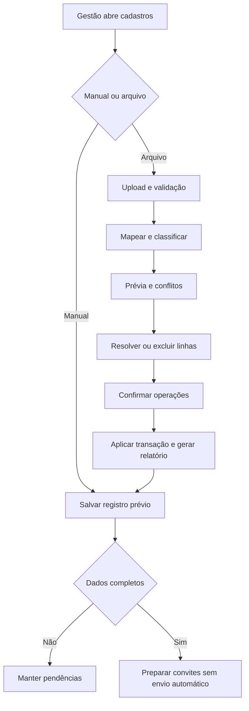
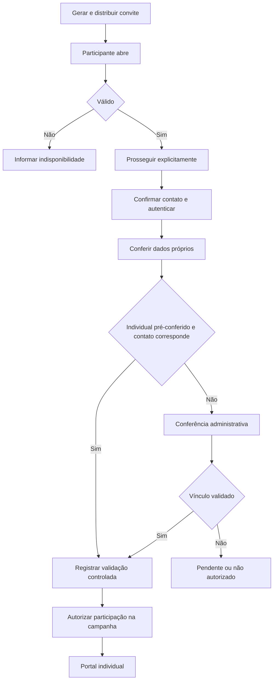
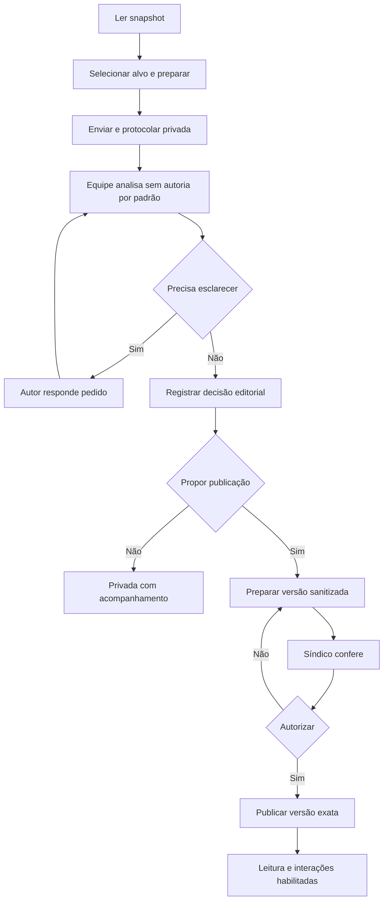
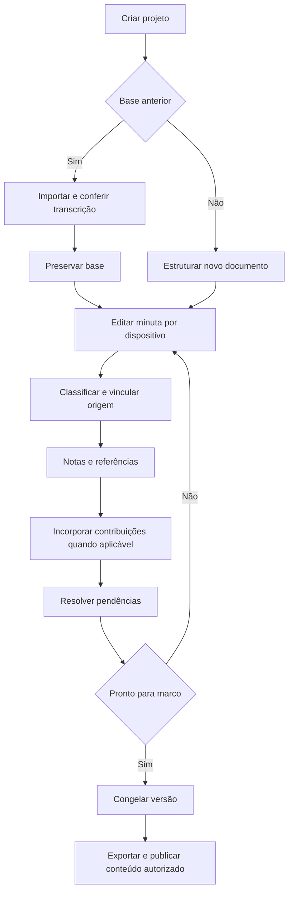
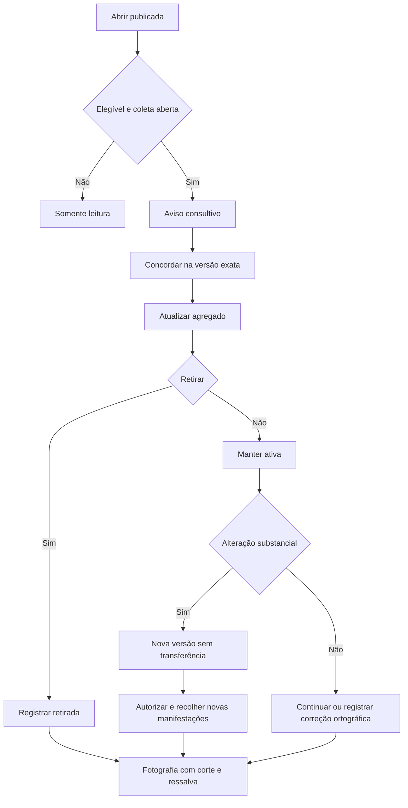

# Telas e jornadas — extração do PRD mestre v3.0

Fonte normativa: docs/prd/PRD_Mestre_v3.md.

## 27. Painel do síndico — telas e contratos de interface

### 27.1. Estrutura global

Menu: visão geral; moradores/acessos; documentos; participação; administração. Header mostra condomínio, projeto/documento/campanha aplicáveis, conta e papel. Trocar condomínio limpa contexto anterior. Breadcrumb e filtros persistem só no escopo correto. Ações escondidas também são negadas pelo backend.

Cada tela tem carregando, vazio, sem resultado, erro, acesso negado, processamento e concluído. Confirmações mostram alvo e efeito. Identidade em telas de conteúdo fica recolhida, buscada só após permissão e auditada. Dados cadastrais aparecem apenas em listagens autorizadas.

### 27.2. Telas administrativas

| ID / rota de UI | Conteúdo, ações e restrições |
|---|---|
| S01 /painel | Dashboard: projetos, pendências, filas, convites e retomada. Não mostrar contatos, ranking pessoal ou aprovação do condomínio. Ações criar projeto, retomar editor, analisar e validar. |
| S02 /painel/pendencias | Lista por tipo/alvo/responsável/prazo; filtrar, atribuir, abrir origem e concluir com motivo. Concluir tarefa não publica nem incorpora. |
| S03 /painel/unidades | Torres/unidades, busca e situação; criar, editar, inativar/reativar; impacto de vínculos. Sem exclusão simples com histórico. |
| S04 /painel/moradores | Abas cadastros prévios, ativados, pendentes, suspensos; filtros unidade/origem/contato/vínculo/campanha; cadastro e detalhe com identificação, contatos, vínculos, convites, participação e histórico. Suspensões distintas. |
| S05 /painel/moradores/importar | Assistente arquivo→mapeamento→normalização→prévia→conflitos→confirmação→relatório. Quantificar ações e avisar que não envia convites nem cria credenciais. |
| S06 /painel/moradores/validacoes | Fila e detalhe de vínculo; método/motivo obrigatórios; validar, rejeitar, esclarecer, suspender/encerrar. Separar contato/vínculo/participação. |
| S07 /painel/convites | Listar modalidade/público/validade/resgates/entrega; wizard de geração, copiar link novo, QR, mensagem/export SMTP opcional; revogar/reemitir com efeito explícito. |
| S08 /painel/projetos | Nome, tipo, coordenação, etapas, docs e pendências; criar/configurar/arquivar preservando histórico. |
| S09 /painel/projetos/:id/documentos | Convenção/Regimento, base, transcrição, minuta, snapshot e campanhas; criar/importar/editar/comparar/exportar. |
| S10 /painel/documentos/:id/importacao | Original e extração, página, incertezas, união/divisão/hierarquia; conferência humana e nova transcrição posterior. |
| S11 /painel/documentos/:id/editor | Árvore, base somente leitura, minuta e contexto; modos e operações por dispositivo, indicadores de salvamento, conflito explícito. |
| S12 /painel/documentos/:id/revisoes | Estrutural, editorial, referências, jurídico e acolhidas sem incorporação; responsáveis, pendência, revisão e parecer. Sem selo de legalidade. |
| S13 /painel/documentos/:id/versoes | Snapshots, finalidade/responsável, leitura imutável, comparar/exportar/restaurar como nova revisão; nunca editar snapshot. |
| S14 /painel/exportacoes | Tipo/versão/perfil/anexos, prévia, fila e resultado; arquivo público sem PII e alerta para relatório interno. |
| S15 /painel/campanhas | Nome, snapshot, período, público, habilitados e recursos independentes; criar/abrir/fechar, toggles de leitura/sugestão/complemento/concordância/contagem. |
| S16 /painel/sugestoes | Fila por análise/editorial/publicação/incorporação, tema, alvo e campanha; abrir, atribuir, esclarecer e duplicidade, sem autoria automática. |
| S17 /painel/sugestoes/:id | Contribuição e contexto, decisão, resposta/nota separadas, identidade restrita, incorporação transacional e histórico. Detalhamento abaixo. |
| S18 /painel/sugestoes/publicacao | Original restrito e versão sanitizada, prévia pública, anexos e checklist; síndico autoriza/devolve/oculta. |
| S19 /painel/campanhas/:id/estatisticas | Pessoas/unidades, versões, denominadores/corte; filtro por tema, fotografia/export agregado. Sem linguagem eleitoral. |
| S20 /painel/equipe | Papéis/permissões/início/término/MFA; convidar, atribuir, revogar e troca de gestão. Identidade/export/publicação separados. |
| S21A /painel/administracao/auditoria | Eventos/filtros ator/ação/recurso/período; leitura restrita, sem editar/apagar. |
| S21B /painel/administracao/configuracoes | Dados/fuso, convites, limites, campos, SMTP, retenção/avisos; confirmar e auditar sensíveis. |

S21 era área única no mapa anterior; agora tem duas páginas efetivas, mantendo identificação histórica. São 22 páginas administrativas agrupadas em 21 áreas funcionais.

### 27.3. Editor detalhado

```text
Documento | Status | Salvamento | Visualização | Ações
----------------------------------------------------
Árvore estrutural | Documento-base | Minuta proposta
----------------------------------------------------
Propriedades | Origem | Notas | Sugestões | Histórico | Referências
```

Árvore mostra rótulo, tipo de mudança, status e pendências; não cor como única informação. Desmembrar/consolidar abre assistente com seleção de origem/destino e prévia. Renumerar mostra antes/depois/referências. Conflito exibe versão utilizada, atual e conteúdo local; resolução cria revisão consistente.

### 27.4. Análise de sugestão detalhada

Header: protocolo, tema, campanha, alvo, versão/data e responsável. Quatro indicadores separados: análise, decisão editorial, publicação, incorporação.

Coluna contribuição: original, justificativa, alternativa e anexos. Coluna contexto: texto consultado, base e minuta atual, com aviso se já mudou. Abas análise, decisão, publicação, incorporação e histórico.

Autoria por botão restrito, não carregada em payload padrão. Análise: síntese, impacto, revisão técnica necessária, responsável e notas. Decisão: acolhida/parcial/não/duplicada, resposta compartilhável obrigatória; parcial descreve recorte, duplicada exige alvo.

Publicação prepara texto/anexos e prévia, mas só síndico confirma. Incorporação seleciona dispositivos, abre proposta, salva revisão e vínculos na mesma transação; falha não deixa incorporada. Várias sugestões podem fundamentar revisão sem somar manifestações.

Histórico preserva revisões, pedidos, respostas, decisões e publicação, respeitando autoria restrita para leitores sem permissão.

## 28. Portal do morador

Navegação: consulta atual, documento, publicadas, minhas sugestões, minhas concordâncias, notificações e meu cadastro. Não reutilizar menu administrativo.

| ID / tela | Conteúdo e ações |
|---|---|
| M01 Entrada | Condomínio/campanha/período/regras/situação; prosseguir. Sem cadastro pessoal completo antes de contato verificado. |
| M02 Contato/cadastro | Confirmar contato e identidade Auth, conferir dados próprios, completar telefone/nome/unidade/relação; compartilhado pede validação. Sem enumeração de conta externa. |
| M03 Situação de acesso | Contato, dados, vínculo e autorização separados; responder esclarecimento e ver orientação. |
| M04 Início | Objetivo, snapshot/período/regras/recursos e últimas respostas; ler, sugerir e acompanhar. |
| M05 Documento | Árvore/busca/versão; sugerir por item. Mostra snapshot da campanha, não latest da minuta. |
| M06 Enviar | Alvo/categoria/texto/justificativa/alternativa/anexo; prévia e avisos; protocolo após envio idempotente. |
| M07 Publicadas | Filtros tema/alvo/status/data; cartão sem autoria, com versão/resposta/ações permitidas. |
| M08 Detalhe público | Redação exata, contexto, complementos autorizados, concordar/retirar/sugerir melhoria conforme abertura. |
| M09 Minhas sugestões | Privadas/publicadas/análise/esclarecimentos/decisão/incorporação, sem confundir status. |
| M10 Minha sugestão | Texto, respostas, revisões próprias, publicação/incorporação; sem notas da equipe; edição gera revisão pendente. |
| M11 Minhas concordâncias | Texto/versão/data/status; nova versão informada sem concordância presumida; retirar enquanto aberto. |
| M12A Meu cadastro | Dados/vínculos/contato/referência e pedidos de correção; unidade/relação sujeitos a conferência. |
| M12B Notificações | Validação, esclarecimento, resposta, publicação, incorporação, nova redação e encerramento; sem autoria de terceiro. |

Estados de acesso: convite não resgatado, contato pendente, cadastro incompleto, vínculo em análise, autorizado, suspenso e campanha encerrada. Encerramento mantém leitura permitida e acompanhamento próprio, sem interação nova. Suspensão não revela terceiros nem apaga histórico.

Mensagens específicas para convite expirado/revogado/esgotado/substituído/campanha encerrada. Canal da gestão pode ser configurado, sem contatos privados de moradores.

## 29. Diagramas das jornadas

### 29.1. Cadastro e importação



### 29.2. Convite e autorização



### 29.3. Sugestão e publicação



### 29.4. Revisão documental



### 29.5. Concordância por versão


