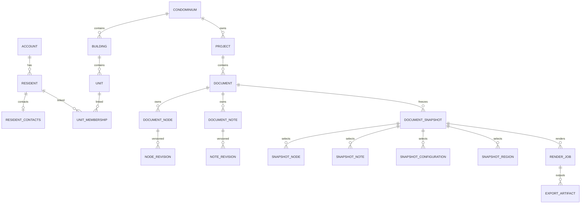

# CONDOC — Modelo de dados Supabase self-hosted DB-1.0

Data: 11/10/2026  
Base: PRD mestre v3.0 e complemento ED-OSS-2.0  
Status: desenho relacional e migrations de referência, ainda não executadas no PostgreSQL

## 1. Escopo e limite

Este pacote implementa o desenho inicial do núcleo cadastral/documental: 41 tabelas, identidades/papéis, unidades/moradores, documentos/revisões, configurações versionadas, notas/regiões, snapshots, importação, renderização e auditoria.

Não é o banco de todo o produto já homologado. Convites, campanhas, sugestões e concordâncias do PRD continuam obrigatórios, mas suas tabelas/regras de fluxo devem ser acrescentadas nas migrations de participação. Não declarar portal completo com estas migrations. Tampouco há renderer/software executável neste pacote.

Schemas novos não são criados com IF NOT EXISTS para esconder conflitos. Destino: instalação nova descartável/homologação. Banco existente exige inventário, mapeamento e migration incremental, preservando IDs. Não executar em produção sem revisão/backup/autorização.

## 2. Organização física

- auth: mantido pelo Supabase Auth; não alterar estruturas internas.
- storage: mantido pelo Supabase Storage; objetos acessados pela API/adaptador, não escrita SQL manual de metadados.
- app: conteúdo e operação documental internos.
- app_private: identidade, contatos, importação sensível e notas internas.
- app_acl: contas locais mínimas, papéis e grants; sem acesso de tabela pelo runtime, somente helpers restritos.
- app_audit: eventos e consultas de identidade, somente acrescentados.

Nenhum schema CONDOC é exposto por PostgREST/Data API. Studio administrativo não é frontend público. A documentação Supabase distingue grants (acesso a objeto) e RLS (linhas), e recomenda schemas internos não expostos. [web:313][web:311]

## 3. Identidade e pessoas

Supabase Auth é a única origem de autenticação. app_acl.accounts.id começa igual ao subject Auth. auth_user_id aponta para auth.users.id e pode tornar-se nulo se a identidade Auth for removida sob procedimento autorizado; UUID histórico permanece e actor_active nega a conta sem identidade atual. Isso evita apagar autoria histórica ou criar senha paralela.

Essa associação pode exigir adaptação à versão anterior do modelo: não migrar/apagar usuário Auth automaticamente. auth.users não deve receber DELETE operacional fora do procedimento aprovado.

Resident é um perfil por conta/condomínio, com nome. ResidentContacts separa telefone/e-mail de contato, permitindo identity.read sem contact.read. E-mail de contato não é a origem autoritativa do login. Cadastros prévios possuem contatos ainda não confirmados e não criam conta.

Vínculo pertence à unidade: pessoa tem N vínculos, unidade N moradores; uma única relação não encerrada por par. Relação declarada, validação e estado operacional separados. Validar/rejeitar exige método/ator/data/motivo. Eventos detalhados de decisão integram auditoria/serviço.

## 4. Relações principais



## 5. Conteúdo, revisões e origem

DocumentNode é identidade estável. NodeRevision contém pai/ordem/rótulo/body rich JSON, numbering/style refs, tipo de mudança e autoria. Revisões são append-only; restaurar cria outra. Não guardar duas cópias editáveis caput/article.

Body JSON precisa validar schema na aplicação: CHECK jsonb_typeof garante apenas tipo básico, não gramática Tiptap/CONDOC. Caput único, ciclos, child order, nota/field pointers e namespaces são validados pelo Core antes de aceitar e congelar.

SourceTranscription/SourceBlock preservam original conferido. Como revisões são imutáveis, etapa de conferência trabalha em staging; uma revisão confirmada é inserida nova com checked_by/at. Não UPDATE para confirmar um registro histórico. Transcrição com check nulo não é base final autorizada.

OriginMapping é muitos-para-muitos e restrito ao mesmo documento. CrossReference pode ligar Convenção e Regimento no mesmo condomínio por UUID, com source revision e target document/node.

## 6. Configurações versionadas

ConfigurationVersions reúne famílias style/layout/table_style/template/block_catalog/numbering/font_manifest. Kind + family_id + version distingue revisões, payload validado por JSON schema da aplicação.

SnapshotConfiguration escolhe a versão de cada slot. O Core verifica que slot style aponta para kind style etc.; FK só garante mesmo tenant/existência. Uma família nova não sobrescreve perfil congelado. Nenhum lookup latest durante renderização.

Em fase posterior, subdividir em tabelas específicas se houver necessidade de constraints/consulta. Não manter texto ou versão concorrente em duas fontes.

## 7. Notas e regiões

DocumentNote tem UUID/kind; NoteRevision tem conteúdo rico. NoteReference aponta nó/revisão/pointer e nota; snapshot escolhe revision/number. Evitar números como identidade. Sem nota dentro de nota ou ponteiros órfãos: validação Core.

RegionRevision tem header/footer, default/first/odd/even, state template/explicit/cleared e body. Vazio explícito não é fallback. SnapshotRegion seleciona revisão exata. Dados normativos não dependem da página visual.

## 8. Snapshot imutável

Estado building permite composição; congelar exige Core validar árvore/refs/campos/layout/compatibilidade e gravar manifest/hash/frozen_by/at.

Triggers bloqueiam UPDATE/DELETE do snapshot congelado e INSERT/UPDATE/DELETE de seus filhos. Guard de filho faz lock no pai, coordenando composição e congelamento. FK liga node/revision/document corretos; nota/revision idem.

Checks e triggers não comprovam preflight jurídico/semântico. Não marcar frozen apenas porque SQL permite: endpoint freeze deve executar validator e testes. Formar, validar e congelar na mesma unidade transacional adequada, sem jobs lendo building.

## 9. Render e arquivos

RenderJob referencia snapshot; Core só aceita snapshot frozen, confirma grants/profile e opções. Estado queued/preflight/rendering/finalizing/validating/ready/failed/cancelled, idempotency por ator/tenant. Revisão de status é operação, não mudança do conteúdo congelado.

ExportArtifact liga job/file/type e manifesto. Arquivo tem bucket/object_key/MIME/size/hash, sem nome pessoal na tabela operacional. FileMetadata separado contém nome original/autor/restritos. Granularidade por recurso/perfil/visibilidade também no Core; file.read de tenant não autoriza qualquer download automaticamente.

Objetos Storage não ficam no dump do banco: ele contém metadados. Backup/restore precisam copiar objetos separadamente e conferir hashes. [web:310][web:312]

## 10. Autorizações e política inicial

ACL separada não usa políticas que consultam mutuamente tabelas protegidas, evitando recursão. app_acl tabelas não são concedidas ao runtime, não expostas e consultadas por funções SECURITY DEFINER com owner sem superuser/BYPASSRLS e search_path vazio.

Essa exceção ao RLS se limita ao catálogo ACL inacessível diretamente. Conteúdo/privado/audit usam ENABLE/FORCE RLS. Accounts/role grants não ficam sujeitos a RLS recursiva; acesso só por funções fixas e migration/admin controlado. Funções definer em schema exposto e search_path solto são riscos documentados. [web:311]

Runtime condoc_api herda condoc_runtime e não condoc_owner. Login sem senha fornecida pelo pacote, segredo provisionado fora do git. Migrations administrativas separadas. Não conectar aplicação como postgres/service_role/owner.

Seed cria códigos, não pessoas/tenants reais. Síndico possui permissões administrativas listadas. Admin base não recebe identity/contact/export pessoal automaticamente: grant individual explícito e papel admin ativo necessários. Council/commission/legal não obtêm identidade só por grant solto; helper exige também papel admin/syndic para esses dados.

Residentes próprios podem ler seus próprios perfis/contatos. Atualizações próprias passam por serviços específicos; o SQL inicial não abre UPDATE amplo ao morador. Portal/sugestões exigem camada de leitura segura que será adicionada: não conceder document.read a residente para facilitar acesso a snapshot.

## 11. Contexto confiável do Core

Após validar sessão/JWT e escopo real, dentro da transação:

```sql
BEGIN;
SELECT set_config('condoc.actor_id', 'UUID_VALIDADO_PELO_CORE', true);
SELECT set_config('condoc.tenant_id', 'UUID_AUTORIZADO_PELO_CORE', true);
-- Operacoes parametrizadas.
COMMIT;
```

true limita contexto à transação, conforme PostgreSQL. [web:324] Usar parametros do driver, não interpolar strings. Contexto ausente nega leitura/escrita. Testar pool reusado.

Limite de confiança: cliente com credencial direta de condoc_api pode definir contexto e impersonar outro ator. Este desenho pressupõe credencial exclusiva do Core confiável, nunca navegador/morador. RLS não é prova criptográfica de identidade e não protege contra comprometimento completo/SQL injection do Core. Se houver acesso direto de cliente, projetar outro contrato baseado em Auth/RLS, não reutilizar este.

Worker revalida ator/tenant/permissões no job e define contexto na sua transação. Não usar segredo elevado para resolver políticas negadas.

## 12. O que o SQL garante e o que falta implementar

Garante, sujeito a execução/teste: FKs tenant/document/revision, unicidades, formatos/estados básicos, ACL inicial, RLS/contexto, grants restritos, versões/snapshot imutáveis e proteção de colunas de identidade.

Core deve implementar: bootstrap/provisionamento de conta validada; associação cadastro→perfil/vínculo; gerenciamento de papéis/grants por rotinas estreitas e auditadas; conferência/importação; gramática/caput/ciclo; freeze preflight; perfil/render/SBOM; permission scoping por projeto se requerido; publicação/portal; audit payload mínimo e revogação.

Runtime não recebe CRUD livre de ACL. Rotinas de administração de papéis/contas devem ser acrescentadas com autorização/auditoria e não conectando o Core como migration owner. Sem essas rotinas, o modelo ainda não é backend funcional completo.

## 13. Extensões previstas na fase de participação

- ConsultationCampaign e CampaignParticipant com referência de vínculo e histórico.
- AccessInvitation/Redemption com hash, validade e limites.
- Suggestion/Revision, autoria em schema privado, publicação em versão própria.
- PublicationDecision exclusiva síndico.
- SuggestionRelationship/Decision/Incorporation.
- ConsultativeAgreement/Event por participante e versão.
- ConsultationSnapshot para corte agregado.
- Views/RPC de leitura segura de conteúdo publicado, sem identidade ou notas privadas.

Não expor view default como se herdasse RLS corretamente; Supabase documenta atenção ao owner e security_invoker. [web:311] Nenhum voto/quórum funcional. Schema publicado, se vier a existir, é superfície separada com DTO/ACL/testes, não app inteiro.

## 14. Aplicação das migrations

Arquivos ordenados:

1. 0001_roles_schemas.sql: roles/schemas e referência mínima Auth.
2. 0002_core_model.sql: 41 tabelas/FKs/índices.
3. 0003_acl_seed.sql: catálogo de permissões/papéis, sem pessoa real.
4. 0004_rls.sql: helpers, grants e policies por operação.
5. 0005_immutability.sql: revisões/snapshots/auditoria.
6. 0006_identity_guards.sql: identidade/origem não reatribuídas por UPDATE.

Modelo inicial não idempotente intencionalmente; migration runner controla aplicação. Não colar SQL reaplicando até não dar erro. Inventariar Postgres/Supabase release e grants existentes. DDL requer role administrativa autorizada capaz de SET ROLE condoc_owner; configuração PostgreSQL existente não será modificada silenciosamente para permitir.

Não alterar PGRST_DB_SCHEMAS incluindo app por conveniência. Segredos e acesso rede/SSL provisionados pelo operador. Somente host de aplicação/worker autorizado acessa DB via canal seguro. Sem senha default.

## 15. Plano de validação antes de produção

Smoke test fornecido é sem fixtures e deve rodar em banco descartável; não comprova fluxo inteiro.

Suite completa deve provar: ator ausente; tenant cruzado; conta suspensa; role expirada; admin sem identity/contact; conselho mesmo com grant indevido; proprietário próprio; FK cross tenant; snapshot fechado inclusive filhos; revisão imutável; alteração de origem negada; anno author_only; job internal; pool após rollback; exclusão Auth desativa principal; nenhum grant anon/authenticated/service_role; backup/restore objetos.

Teste de write permitido precisa conferir row efetivamente criada/alterada; executar sem erro pode ter modificado zero linhas. Denied USING pode retornar vazio sem exception. Supabase recomenda testar grants e políticas em conjunto. [web:311]

Pacote foi estruturalmente verificado pelo gerador; não foi executado em uma instância PostgreSQL/Supabase. Homologação exige migrations e testes reais no ambiente autorizado.

## 16. Inventário de tabelas

| Schema | Tabela | Leitura inicial | Escrita inicial | Histórico imutável |
|---|---|---|---|---|
| app_acl | accounts | Helpers/admin controlado | Admin controlado | Não / guard específico |
| app_acl | permissions | Helpers/admin controlado | Admin controlado | Não / guard específico |
| app_acl | roles | Helpers/admin controlado | Admin controlado | Não / guard específico |
| app_acl | role_permissions | Helpers/admin controlado | Admin controlado | Não / guard específico |
| app | condominiums | tenant.read | tenant.manage | Não / guard específico |
| app_acl | role_assignments | Helpers/admin controlado | Admin controlado | Não / guard específico |
| app | buildings | unit.read | unit.manage | Não / guard específico |
| app | units | unit.read | unit.manage | Não / guard específico |
| app_private | residents | identity.read | resident.manage | Não / guard específico |
| app_private | unit_memberships | identity.read | resident.validate | Não / guard específico |
| app_private | resident_registrations | identity.read | resident.manage | Não / guard específico |
| app | projects | document.read | document.edit | Não / guard específico |
| app | files | file.read | file.manage | Não / guard específico |
| app_private | file_metadata | identity.read | file.manage | Não / guard específico |
| app | configuration_versions | document.read | document.edit | Sim |
| app | documents | document.read | document.edit | Não / guard específico |
| app | source_transcriptions | document.read | document.edit | Sim |
| app | source_blocks | document.read | document.edit | Sim |
| app | document_nodes | document.read | document.edit | Sim |
| app | node_revisions | document.read | document.edit | Sim |
| app | origin_mappings | document.read | document.edit | Sim |
| app | cross_references | document.read | document.edit | Sim |
| app | document_notes | document.read | document.edit | Sim |
| app | note_revisions | document.read | document.edit | Sim |
| app | note_references | document.read | document.edit | Sim |
| app | region_revisions | document.read | document.edit | Sim |
| app | document_snapshots | document.read | document.freeze | Não / guard específico |
| app | snapshot_nodes | document.read | document.freeze | Não / guard específico |
| app | snapshot_notes | document.read | document.freeze | Não / guard específico |
| app | snapshot_configurations | document.read | document.freeze | Não / guard específico |
| app | snapshot_regions | document.read | document.freeze | Não / guard específico |
| app_private | internal_annotations | annotation.read | annotation.write | Não / guard específico |
| app_private | import_batches | import.read | import.manage | Não / guard específico |
| app_private | import_rows | import.read | import.manage | Não / guard específico |
| app | render_jobs | export.read | document.export | Não / guard específico |
| app | export_artifacts | export.read | document.export | Sim |
| app_private | compatibility_issues | document.read | document.edit | Não / guard específico |
| app_audit | events | audit.read | audit.append | Sim |
| app_audit | identity_access | audit.read | audit.append | Sim |
| app_private | resident_contacts | contact.read | resident.manage | Não / guard específico |
| app_acl | account_permission_grants | Helpers/admin controlado | Admin controlado | Não / guard específico |
