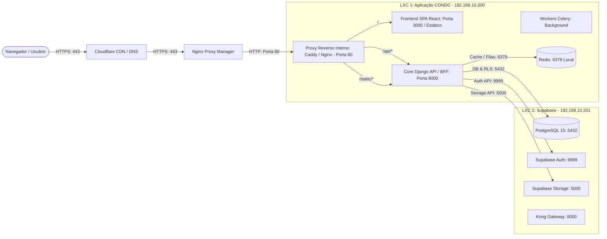

# Arquitetura de Roteamento e Proxy Reverso — CONDC
## Hostname: condoc.fk.adm.br

Este documento descreve a topologia de tráfego, as portas dos serviços, as regras de encaminhamento do **Nginx Proxy Manager (NPM)** e a configuração do proxy reverso interno da **LXC 1** (`192.168.10.200`).

---

## 1. Topologia Geral de Tráfego

---

## 2. Configuração no Nginx Proxy Manager (NPM)

No painel administrativo do seu Nginx Proxy Manager, configure o Proxy Host exatamente conforme abaixo:

### Aba "Details":
* **Domain Names:** `condoc.fk.adm.br`
* **Scheme:** `http`
* **Forward Hostname / IP:** `192.168.10.200`
* **Forward Port:** `80` *(ou diretamente a porta do frontend, mas recomendamos a porta 80 da LXC 1 com o proxy unificador de `/api` e `/`)*
* **Opções a Ativar:**
  * [x] **Cache Assets** (Opcional, recomendado desativado inicialmente para evitar cache em dev)
  * [x] **Block Common Exploits** (Ativado)
  * [x] **Websockets Support** (Ativado — essencial para HMR e canais do Tiptap/notificações)

### Aba "SSL":
* **SSL Certificate:** Certificado Cloudflare Origin ou Let's Encrypt gerenciado pelo NPM.
* **Opções a Ativar:**
  * [x] **Force SSL** (Ativado)
  * [x] **HTTP/2 Support** (Ativado)
  * [x] **HSTS Enabled** (Ativado)

### Aba "Custom Locations" (Opcional se usar a Porta 80 unificada na LXC 1):
Se você preferir que o NPM faça o roteamento direto sem proxy interno na LXC 1:
1. **Location Padrão (`/`):**
   * Encaminha para `192.168.10.200` na porta `3000` (Frontend React SPA).
2. **Custom Location (`/api/`):**
   * Encaminha para `192.168.10.200` na porta `8000` (Core Django REST API).
3. **Custom Location (`/static/`):**
   * Encaminha para `192.168.10.200` na porta `8000` (Arquivos estáticos do Django).

> **Recomendação de Arquitetura (PRD Mestre v3.0, Seção 24):**  
> Recomendamos encaminhar o NPM para a **porta 80** da LXC 1. Na porta 80 da LXC 1 teremos um Caddy/Nginx unificador local. Isso garante **Same-Origin** nativo entre `/` (Frontend) e `/api` (Backend), eliminando 100% dos problemas de cookies entre domínios e complexidades de CORS/SameSite.

---

## 3. Mapeamento de Portas na LXC 1 (`192.168.10.200`)

| Serviço | Porta Interna | Porta Exposta na LXC 1 | Função |
|---|---|---|---|
| **Proxy Unificador (Caddy / Nginx)** | 80 | **80** (Recebe do NPM) | Recebe o tráfego do NPM e roteia `/` para o Frontend e `/api/` para o Core Django |
| **Frontend SPA (React / Vite)** | 3000 | 3000 (Interna/Docker) | Interface do Síndico e Portal do Morador |
| **Core Django API (BFF)** | 8000 | 8000 (Interna/Docker) | Endpoints REST v1, autenticação BFF, regras de negócio e RLS |
| **Redis Server** | 6379 | 127.0.0.1:6379 (Privada) | Broker do Celery e cache local da aplicação |
| **Celery Workers** | N/A | Processo em background | Execução de OCR (Tesseract), conversões e tarefas assíncronas |

---

## 4. Cabeçalhos HTTP Mandatórios para o NPM / Cloudflare

Para que a segurança de cookies do padrão BFF (`Secure`, `HttpOnly`, `SameSite=Lax`) e a identificação do IP real do morador/síndico funcionem com precisão:

* `Host: $host`
* `X-Real-IP: $remote_addr` (ou `CF-Connecting-IP` vindo da Cloudflare)
* `X-Forwarded-For: $proxy_add_x_forwarded_for`
* `X-Forwarded-Proto: https` (Mandatório para que o Django reconheça a requisição como HTTPS segura)
